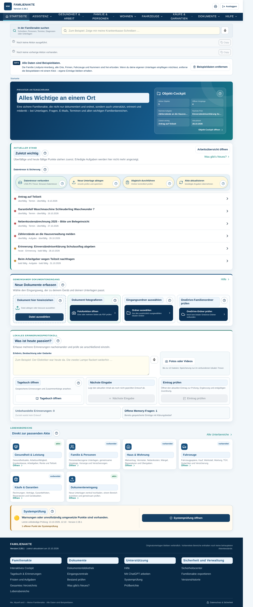
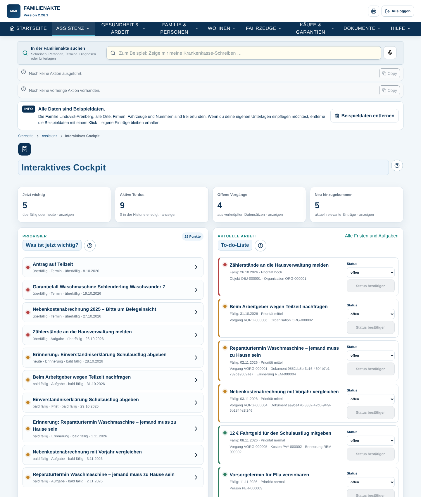
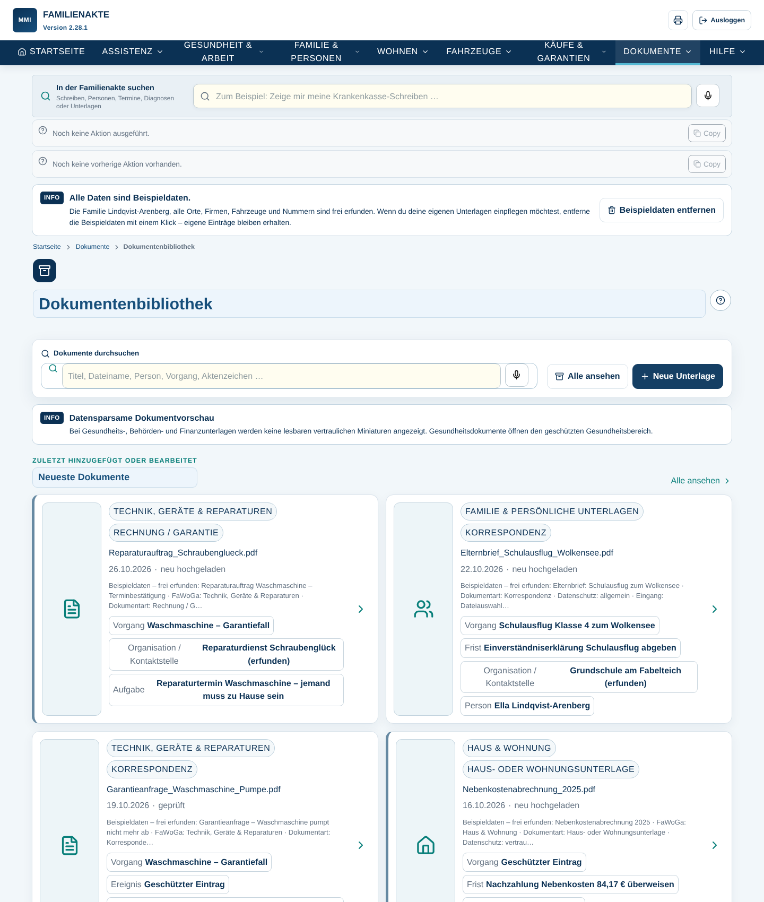
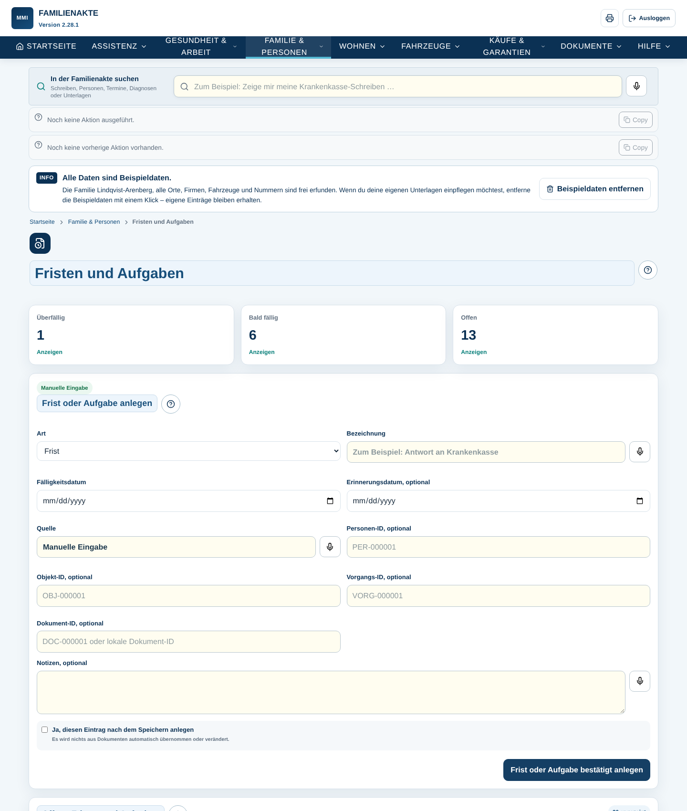
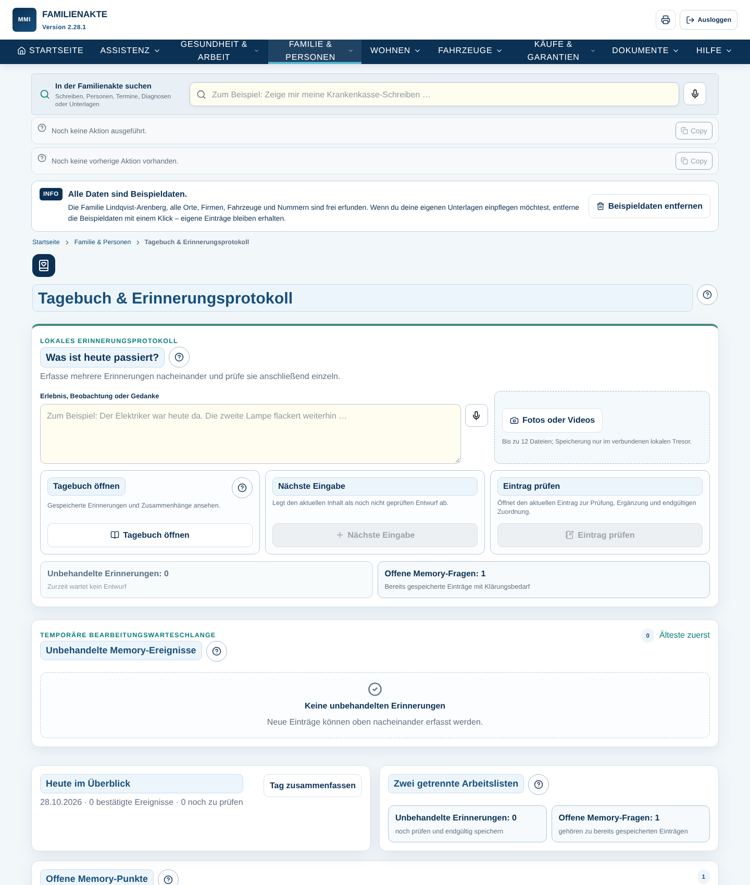
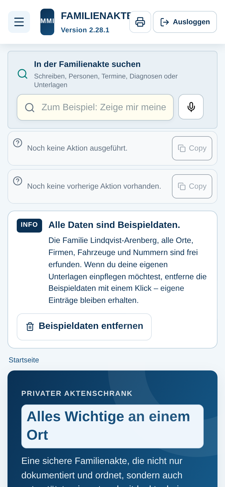

# Meine Familienakte

Private Familienakte im Browser: Gesundheit & Vorsorge, Arbeit, Familie & Personen,
Wohnen, Fahrzeuge, Käufe & Garantien, Dokumente, Assistenz, Fristen, Tagebuch,
Export und Hilfe – auf Deutsch, am PC und auf dem Handy.

Aufbau, Funktionen und Gestaltung entsprechen der bisherigen App (Version 2.28.1).
Neu ist nur die Technik darunter: Die App läuft jetzt vollständig im Browser, ohne
Server und ohne bestimmten Hosting-Anbieter.

> **Alle Daten sind Beispieldaten.** Die Familie Lindqvist-Arenberg, alle Orte, Straßen,
> Postleitzahlen, Firmen, Marken, Fahrzeuge und Nummern sind frei erfunden.

## Starten

Voraussetzung: Node.js 22.

```
npm install
npm run dev
```

Dann im Browser öffnen: http://127.0.0.1:5173/

Beim ersten Start legt die App die erfundene Beispielfamilie im Browser-Datentresor an
(dauert wenige Sekunden).

| Befehl | Zweck |
| --- | --- |
| `npm run dev` | Entwicklungsserver mit automatischem Neuladen |
| `npm run build` | alle automatischen Prüfungen, Typprüfung und fertiger Build in `dist/` |
| `npm run preview` | den fertigen Build lokal ansehen |
| `npm run check` | nur die automatischen Prüfungen (Fachlogik und Systemprüfung) |
| `npm run screenshots` | Screenshots nach `docs/screenshots/` (laufende App und Playwright nötig) |

Der Ordner `dist/` kann auf jeden beliebigen Webserver oder in einen beliebigen
Unterordner kopiert werden.

`npm run build:single` erzeugt zusätzlich `dist-single/meine-familienakte.html` – die ganze
App in einer einzigen Datei. So läuft sie auch als eingebettete Seite (z. B. als Link auf
claude.ai). Dort gelten Browser-Einschränkungen: Rückfragen erscheinen als Dialog in der
Seite, Dokumente öffnen sich in einer Vorschau, Ordnerauswahl, Drucken, Mikrofon und
Datei-Downloads stehen eingebettet nicht zur Verfügung.

## Beispieldaten entfernen

Oben auf jeder Seite steht der Hinweis „Alle Daten sind Beispieldaten.“ mit dem Knopf
**Beispieldaten entfernen**. Ein Klick (plus Bestätigung) entfernt alle Beispieleinträge
und Beispieldokumente. Eigene Unterlagen und Einträge bleiben erhalten. Über
„Beispieldaten laden“ ganz unten auf der Seite lässt sich die Beispielfamilie jederzeit
wieder anlegen.

## Wo liegen die Daten?

- **Browser-Datentresor (Standard):** Die Daten liegen im geschützten Dateispeicher dieses
  Browsers (Origin Private File System). Kann der Browser dort nicht schreiben (z. B. ältere
  Safari-Versionen auf iPhone/iPad), nutzt die App automatisch IndexedDB. Die Daten
  verlassen das Gerät nicht.
- **Eigener Ordner:** In Chrome oder Edge kann unter „Datentresor & Sicherung“ ein Ordner
  auf dem PC, USB-Stick oder im OneDrive-Ordner gewählt werden – wie in der bisherigen App.
- **Sicherung, Wiederherstellung und Export** laufen über das Sicherheitscenter und
  „Familienakte exportieren“.

## Installierbare App

Die App bringt ein Web-App-Manifest mit und lässt sich in Chrome/Edge als App installieren.
Ein Offline-Cache (Service Worker) oder eine Desktop-App kann später ergänzt werden.

## Aufbau des Codes

- `app/` – Oberfläche (unverändert aus der bisherigen App) sowie
  `sample-family.ts` (Beispielfamilie) und `browser-uploads.ts` (Ersatz für die früheren
  Server-Schnittstellen)
- `lib/` – Fachlogik (Zuordnung, Suche, Fristen, Export, Tagebuch …) und
  `sample-pdf.ts` (erzeugt die Beispiel-PDFs selbst)
- `scripts/` – automatische Prüfungen und Screenshot-Skript
- `docs/screenshots/` – Screenshots mit Beispieldaten

## Screenshots

| Startseite | Cockpit | Dokumentenbibliothek |
| --- | --- | --- |
|  |  |  |
| **Fristen und Aufgaben** | **Tagebuch** | **Handy** |
|  |  |  |

Der ursprüngliche Arbeitsauftrag steht in [NEUSTART_AUFTRAG.md](NEUSTART_AUFTRAG.md).
Der Auftrag für die Funktions- und KI-Analyse steht in [docs/ANALYSE_AUFTRAG.md](docs/ANALYSE_AUFTRAG.md).
