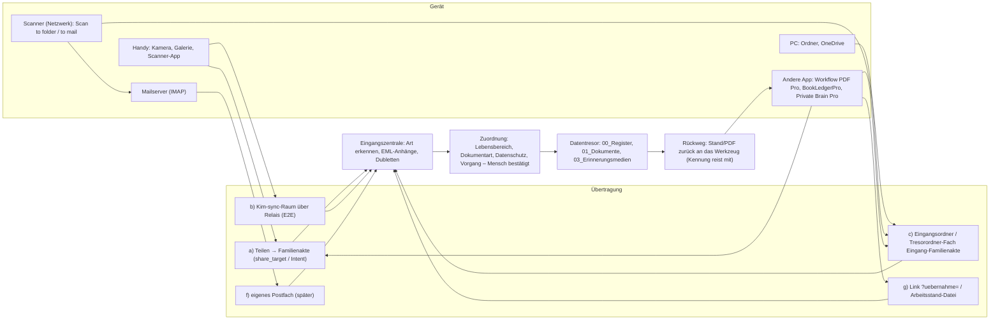

# Paket G: Dateien von anderen Geräten – Handy-Foto, Scanner, andere Apps, E-Mail

Stand 28.10.2026. Nachgelesen in den Klonen (Privat-Brain-Pro `b0a28dd`, BookLedgerPro `f6633c8`, Kim-sync `1230cab`,
Workflow-PDF-Pro `c85234e`); nichts am Gerät gemessen. Klaus' Zusatz von heute ist eingearbeitet: eigenes E-Mail-Postfach wie
bei Private Brain, Mails einordnen und an BookLedgerPro weiterleiten, PDF-Scanner, Werkzeuge einladen und Daten hin und zurück.

## G1 · Ist-Stand in der Familienakte

| Weg | Was heute passiert | Fundstelle | Umgebung |
| --- | --- | --- | --- |
| Drag & Drop / Dateiauswahl | Dateien gehen in die Eingangszentrale (`queueCentralIntakeFiles`), Art wird erkannt (PDF, Word, Foto, Text, EML, MSG, Tabelle, Archiv, unbekannt), Zuordnungsvorschlag, Dubletten, „Trotzdem übernehmen“ | `app/central-intake-center.tsx`, `lib/central-intake.ts` `detectCentralIntakeFileKind`, `lib/document-intake.ts` | überall |
| „Dokument fotografieren“ | `<input type="file" accept="image/*" capture="environment" multiple>` → Scan-Dialog (drehen, zuschneiden, Reihenfolge) → eine PDF aus JPEG-Seiten (`createDocumentScanPdf`, eigener PDF-Schreiber ohne Bibliothek) → Eingangszentrale; Originale nur auf Wunsch als Anlagen | `app/central-intake-center.tsx` Zeile 89–94, `app/document-scan-dialog.tsx`, `lib/document-scan.ts` | Handy öffnet die Kamera; am PC die Dateiwahl (kein Live-Kamerabild, kein `getUserMedia`) |
| Eingangsordner | „Eingangsordner auswählen“ → `showDirectoryPicker` → `scanLocalInbox`: neue/geänderte Dateien gegen das Register, dann Eingangszentrale (`source: "local-inbox"`) | `app/local-vault.ts` `chooseInboxFolder`/`scanLocalInbox`, `health-portal.tsx` Zeile 669 | nur Chrome/Edge am PC |
| OneDrive-Posteingang | gleicher Weg über den gewählten OneDrive-Ordner, Unterordner `00_Posteingang` wird angelegt; **keine** Dauerüberwachung, nur auf Knopf („OneDrive-Automatik“ ist pausiert in `lib/system-check-manifest.json`) | `local-vault.ts` Zeile 331/801, `health-portal.tsx` 676 | nur Chrome/Edge am PC |
| E-Mail `.eml` | Kopfzeilen werden gelesen (`parseEmlText`), Anhänge mit `extractEmlAttachments` (multipart eine Ebene, base64/quoted-printable) als eigene Dateien angeboten, „bestätigte Anlagen-Verknüpfung“ | `lib/central-intake.ts` Zeile 121–200, `health-portal.tsx` 640 | überall |
| Outlook `.msg` | nur erkannt (Dateiendung), **nicht gelesen** (binäres OLE-Format) → „Prüfung erforderlich“ | `central-intake.ts` Zeile 88 | – |
| ZIP | nur erkannt als „Archivdatei“, **nicht entpackt** | `central-intake.ts` Zeile 91 | – |
| Von einem anderen Gerät | **kein Weg**: kein `share_target`, kein Android-Intent, keine Kopplung, kein Postfach | – | – |

Der Datentresor legt `Me_Myself_and_I_Familienakte/00_Register`, `01_Dokumente`, `02_Online-Bestand_gesichert`,
`03_Erinnerungsmedien` an (`local-vault.ts` 800–804); `00_Posteingang` nur im OneDrive-Fall.

## G2 · Vorlagen in Klaus' Repos (kurz, mit Fundstellen)

| Repo | Baustein | Fundstelle | Was es kann |
| --- | --- | --- | --- |
| Privat-Brain-Pro | Teilen-Empfang Android | `android/…/ProSharePlugin.java` (120 Z.), `ShareInbox.java` (96 Z.), `native/native-share.js` (79 Z.), `docs/TEILEN-EMPFANG.md` | `ACTION_SEND`/`SEND_MULTIPLE`, nur `content://`, privater Eingangskorb im App-Cache, stückweises Lesen, danach löschen; Text ohne Datei → Textdatei |
| BookLedgerPro | Teilen-Empfang Android + „Öffnen mit“ | `android/…/IncomingInbox.java`, `IncomingFiles.java`, `BlpIncomingPlugin.java`, `native/blp-native.js` Teil 1 (`launchQueue`-Nachbau), Manifest `SEND`/`VIEW` für PDF/Bild/`.eml` | wie oben, zusätzlich „Öffnen mit“; Archiv 14 Tage statt Löschen |
| BookLedgerPro (PWA) | `share_target` | `manifest.webmanifest` Zeile 18–32 (`./teilen-empfang`, POST, `dateien`), `sw.js` Zeile 296–301 (Worker legt in Vorrat `blpr-geteilt`, leitet auf `./?geteilt=1`), `file_handlers` | PWA steht in Androids Teilen-Liste; **Lehre Kim-sync 2026-10-06:** ohne aktiven Worker antwortet Pages mit 405 → Worker vor dem Start anmelden |
| Kim-sync | Geräte-Kopplung über Raum-Code | `index.html` (`raumOeffnen`, `neuerRaumSchluessel`), `modules/krypto.js` (byte-1:1 aus Datei-Post), `05b_nostr_relay.js`, `23_rendezvous.js`, `echtheit.js`; `README.md` | AES-GCM auf dem Gerät, Teile zu 90 000 Zeichen über Nostr-Relais (Klaus' `relay.family-projekt.de`, `relay-privat.…` mit Zulassungsliste), Quittung, Löschen vom Relais, empfangene Bilder neu gezeichnet, Teilen-Ziel, Tresor für Räume, Einladungslink mit Token |
| BookLedgerPro | Relais-Weg für App-Übergaben (Plan) | `docs/design/PLAN-TRESORORDNER-2026-10-26.md` „Weg 2 — Relais“ | Zettel `typ: 'uebergabe'`, `an: <App>`, `vertrag: <Name>`; „Verbund-Raum“ für alle eigenen Apps; Krypto byte-1:1 aus Kim-sync; offene Fragen an Klaus (ein Raum oder Paarung; Basic oder nur Pro) |
| Workflow-PDF-Pro | gemeinsamer Tresorordner `de.familyprojekt.tresor` | `android/app/src/main/java/de/familyprojekt/tresor/*` (10 Dateien, reines Java), `docs/TRESORORDNER.md` | ein Passwort, Fächer `Private Brain/`, `Workflow PDF Pro/`, `BookLedgerPro/`, `Eingang-BookLedgerPro/`, `Eingang-WorkflowPDF/`; Inhaltsverzeichnis je Fach, Marken „übernommen“, nie Löschen in fremden Fächern; Ersatzschlüssel 5/3 |
| Privat-Brain-Pro | Schreibseite ins Eingangsfach | `docs/TRESORORDNER.md`, `native/native-tresorordner.js`, `ProMailPlugin.tresorMailAblegen` | „An BookLedgerPro teilen“ legt die `.eml` verschlüsselt nach `Eingang-BookLedgerPro/Mails/` |
| BookLedgerPro | Leseseite aus dem Eingangsfach, Mail-Beleg | `docs/MAIL-TEILEN.md`, `src/domain/mailEml.js` (MIME beliebig tief, HTML→Text), `src/domain/belegPositionen.js` | Mail als Beleg, Anhänge als eigene Belege, Positionen aus der Rechnung |
| Privat-Brain-Pro | eigenes Postfach (Android/Windows) | `android/…/MailEngine.java` (472 Z., IMAP/SMTP mit TLS), `ProMailPlugin.java` (323 Z.), `MailMime.java` (246 Z.), `EncryptedMailStore.java` (116 Z., AES-GCM/Keystore), `MailIndex.java`, `MailOutbox.java`, Gmail-OAuth (6 Dateien), `native/native-mail*.js` (7 Dateien), `assets/live-mail.js` (1328 Z.), Windows: `windows/engine/` (Java-Kern), `docs/NATIVE-MAIL-ARCHITEKTUR.md`, `docs/MAIL-ANBIETER.md` | Telekom, Hetzner, Google (OAuth), WEB.DE, GMX, Yahoo, IONOS; Passwort nur im nativen Dialog; Löschen/Verschieben/Spam, Newsletter-Abmelden, Aufräumen; **PWA:** nur über den privaten HTTPS-Mail-Dienst `mail-service/` (`docs/MAIL-DIENST.md`) |
| Workflow-PDF (Web) / Workflow-PDF-Pro | Scanner-Kern | `upstream/workflow-pdf/assets/scanner.js`, `scan-bild.js`, Scanic, Tesseract; Start mit `./?scan=1&von=BookLedgerPro`, „Durchsuchbar“ vorbelegt | mehrseitig, Entzerren, OCR-Textebene, Qualitätsstufen; in BookLedgerPro byte-1:1 eingebettet (`assets/wfpdf/`, `docs/SCANNER-IN-BLP.md`) |
| BookLedgerPro | Werkzeug-Übergabe mit Rückweg | `docs/UEBERNAHME_TOMY.md` (v1/v2 `?uebernahme=<base64url(JSON)>`, R1–R3 Stand zurück), `docs/WORKFLOW-PDF-EINBINDUNG.md` (Weg 3: `*.workfloh.json` hin, unterschriebenes PDF zurück über Teilen + Marke im PDF), `apps/calculate`, `apps/needs` eingebettet byte-1:1 mit Brücke `apps/blp-bruecke.js` | Daten übergeben, Mensch bestätigt, Ergebnis kommt per Link/Teilen zurück, Zuordnung über Kennung |

## G3 · Varianten

### a) Teilen an die Familienakte (Handy: Galerie, Kamera, Scanner-App, Mail-App → „Teilen → Familienakte“)

- **PWA:** `share_target` im Manifest (POST `./teilen-empfang`, Dateien `application/pdf, image/*, message/rfc822, .docx, .xlsx, .txt, .msg, .zip`),
  Service Worker legt die Dateien in einen eigenen Vorrat und leitet auf `./?geteilt=1`; die App holt sie dort ab und ruft
  `queueCentralIntakeFiles(files, "share")` → Eingangszentrale mit Zuordnungsvorschlag. Muster BookLedgerPro `sw.js`/`manifest`.
  Voraussetzung: https-Adresse (Pages) und installierte PWA. Nur Android zeigt Web-Apps in der Teilen-Liste; iOS nicht.
- **APK:** Intent-Filter `SEND`/`SEND_MULTIPLE`/`VIEW` + `IncomingInbox` (BookLedgerPro) → derselbe Abholweg.
- Die Eingangszentrale braucht einen neuen `DocumentIntakeSource`-Wert (`"share"`), sonst bleibt alles wie beim Freund.
- Aufwand: **klein** (Muster fertig). Datenschutz: Datei verlässt das Gerät nicht.

### b) Kim-sync-Kopplung (Handy fotografiert → PC empfängt)

- Handy und PC teilen einen Raum-Code; das Handy sendet verschlüsselt über Klaus' Relais, der PC holt ab, solange die
  Familienakte offen ist (kein Hintergrunddienst in einer PWA). Die Familienakte zeigt die Datei in der Eingangszentrale als
  „Eingang: anderes Gerät“.
- Bausteine byte-1:1 aus Kim-sync: `modules/krypto.js`, `echtheit.js`, `noble-secp256k1.js`, Relais-Teil aus `05b_nostr_relay.js`;
  die Raum-Logik steckt in `index.html` (246 KB, nicht modular) und müsste als eigener Baustein herausgelöst werden – das ist
  der eigentliche Aufwand. BookLedgerPro plant denselben Weg als „Verbund-Raum“ (Plan Weg 2) – **Entscheidung von Klaus**, ob ein
  Raum für alle Apps oder Paarung je Gerät.
- Aufwand: **groß** (Raum-Logik herauslösen, UI im Freund-Design, Relais-Zulassung je Gerät). Datenschutz: gut (Ende-zu-Ende,
  Relais sieht nur Geheimtext), aber ein Relais im Netz ist beteiligt und der Internetschalter muss an sein.
- Einfachere Zwischenlösung: Kim-sync selbst nutzen (Foto in Kim-sync senden, am PC „⬇ Speichern“ → Eingangsordner der
  Familienakte). Null Aufwand, zwei Apps.

### c) Gemeinsamer Eingangsordner / Tresorordner-Fach `Eingang-Familienakte/`

- **Nativ (APK/Windows):** die Familienakte zieht in den gemeinsamen Tresorordner der Pro-Apps ein (Paket `de.familyprojekt.tresor`
  byte-gleich aus Workflow-PDF-Pro, Fach `Familienakte/`, Eingangsfach `Eingang-Familienakte/`). Private Brain Pro, BookLedgerPro
  und Workflow PDF Pro legen dort Dateien ab (Rechnungs-Mails, gescannte PDFs); die Familienakte liest das Inhaltsverzeichnis,
  übernimmt mit Marke „übernommen“, löscht nie. Umgekehrt legt die Familienakte eine Mail nach `Eingang-BookLedgerPro/Mails/`
  (genau so, wie Private Brain Pro es heute tut) – das ist Klaus' „an BookLedgerPro weiterleiten“.
- **Brief-Entscheidung:** erster Bau mit eigenem Tresor; der Einzug ist ein späterer Schritt. Das Tresor-Paket ist reines Java
  (Android, JVM) – unter Windows müsste es entweder die Java-Engine von Private Brain Pro mitbringen oder einen Rust-Zwilling
  bekommen (offene Lücke auch bei Workflow PDF Pro laut `docs/TRESORORDNER.md`).
- **Alternative ohne Tresorordner (PC):** ein synchronisierter Ordner (OneDrive o. ä.) als Eingangsordner – gibt es heute schon
  („Eingangsordner auswählen“, `00_Posteingang`), nur ohne Überwachung: Klaus drückt „Eingang prüfen“.
- Aufwand: **mittel** (Android: Plugin wie `BlpTresorPlugin`; Windows: offen). Datenschutz: sehr gut (ein Passwort, alles
  verschlüsselt, gleiche SD-Karte).

### d) Scanner

- **Mobile Scanner-Apps** (Microsoft Lens, Adobe Scan, Workflow PDF Pro): übergeben per Teilen → Variante a.
- **Workflow PDF Pro als PDF-Scanner einladen** (Klaus: „PDF-Scanner und so weiter“): Knopf „Mit Workflow PDF scannen“ → öffnet
  Workflow PDF (`./?scan=1&von=Familienakte`, „Durchsuchbar“ an); das fertige PDF kommt per Teilen zurück (a) oder über das
  Eingangsfach (c). Genau so macht es BookLedgerPro (`docs/WORKFLOW-PDF-EINBINDUNG.md`, Weg 1). Alternativ den Scanner-Kern
  byte-1:1 einbetten wie BookLedgerPro (`assets/wfpdf/`, 13 Proben) – das ändert aber den Dialog „Dokument fotografieren“ des
  Freundes nicht, sondern käme daneben: nur mit Klaus' Wort.
- **Netzwerk-/Multifunktionsgeräte:** „Scan to folder“ → Eingangsordner (c-Alternative); „Scan to mail“ → `.eml`-Import (heute)
  oder eigenes Postfach (f).

### e) QR-Code-Kopplung

- PC zeigt den Raum-Code (b) oder Einladungslink als QR; Handy scannt mit der Kamera (Android-Kamera erkennt QR von selbst) und
  öffnet den Link `…/?raum=…`. Kim-sync hat heute Einladungslink + Teilen, aber **keinen QR-Code** (`grep` in `index.html` trifft nur Zeichenlisten wie `…PQRS…`, keine QR-Funktion).
  QR erzeugen geht ohne Bibliothek (kleiner Encoder, ~300 Zeilen) oder mit einer gepinnten lokalen Kopie; kein CDN.
- Aufwand: **klein**, aber nur sinnvoll zusammen mit b.

### f) Eigenes E-Mail-Postfach wie Private Brain Pro (Klaus' Zusatz 2026-10-28)

Was Private Brain Pro hat und was davon übernehmbar wäre:

| Teil | Private Brain Pro | Übernahme in die Familienakte | Aufwand |
| --- | --- | --- | --- |
| IMAP/SMTP-Kern Android | `MailEngine.java`, `MailMime.java`, `MailAccount.java`, `MailProvider.java` (Vorlagen Telekom/Hetzner/WEB.DE/GMX/Yahoo/IONOS), `EncryptedMailStore.java`, `MailOutbox.java`, `MailIndex.java`, `ProMailPlugin.java` | Als Dateien in `android/` übernehmbar (Paketname), ohne Oberfläche | mittel (Java bauen/linten nur in CI) |
| Gmail OAuth | `GmailAuthorization.java` & Co., eigenes Google-Cloud-Projekt `privat-brain-pro`, Client-ID gehört zur App | Nicht übernehmbar ohne eigene Google-Registrierung | groß (Klaus-Schritte bei Google) |
| Windows-Kern | `windows/engine/` (Java 21 mitgeliefert, 100 MB Setup) | übernehmbar, verdoppelt das Setup | mittel |
| Oberfläche | `assets/live-mail.js` + `mail-workspace.js` (Sende-Prüfer-Aufbau, 4 Sprachen) | **nicht** ins Design des Freundes übertragbar; die Familienakte bräuchte ein eigenes Postfach-Panel im Stil der Korrespondenz-Seite | groß |
| PWA | nur über den privaten HTTPS-Mail-Dienst (`mail-service/`, Hetzner) | derselbe Dienst wäre nutzbar | klein, aber Server nötig |
| Einordnen → Familienakte | Mail öffnen → „In die Akte übernehmen“ = `.eml` + Anhänge in die Eingangszentrale (heute schon `extractEmlAttachments`) | kleiner Klebstoff | klein |
| Weiterleiten → BookLedgerPro | „An BookLedgerPro teilen“ (`.eml` per Teilen oder ins Tresorordner-Eingangsfach) | wie PBP `shareBookLedger` | klein |

Empfehlung („im Hinterstübchen“): **Schritt 1** jetzt: nichts Sichtbares; im APK-Bau die Java-Mail-Dateien noch **nicht**
mitnehmen, aber den Datenvertrag „Mail → Akte“ festlegen (eine `.eml` plus Anhänge = Eingangszentrale, Quelle `"mail"`).
**Schritt 2** (eigene Sitzung): Postfach-Panel im Freund-Design, Kern aus PBP byte-gleich mit Pins. Eine Vorsortierung der
Mails in Lebensbereiche kann die vorhandene `buildDocumentIntakePlan`-Logik übernehmen (Betreff + Absender als `textHint`).

### g) Werkzeuge einladen: Daten übergeben und zurück (Klaus: „Tools zusätzlich einladen und die Daten nur übergeben und dann wieder zurück“)

Das ist genau das BookLedgerPro-Muster, und es ist das **leichteste** mit dem größten Nutzen:

| Richtung | Vertrag | Vorlage |
| --- | --- | --- |
| Familienakte → Workflow PDF Pro („Formular ausfüllen / scannen“) | Link `…/?scan=1&von=Familienakte` bzw. Arbeitsstand `*.workfloh.json` + PDF per Teilen | `docs/WORKFLOW-PDF-EINBINDUNG.md` Weg 1 und 3 |
| Workflow PDF Pro → Familienakte (fertiges PDF) | Teilen (a) oder Eingangsfach (c); Zuordnung über eine Marke im PDF (`Keywords: familienakte=<Dokument-Kennung>`) wie `blp-angebot=…` | Weg 3 Rückweg |
| Familienakte → BookLedgerPro (Rechnung aus einer Mail oder aus „Käufe & Garantien“) | `.eml` per Teilen / `Eingang-BookLedgerPro/Mails/`; Daten als `?uebernahme=<base64url(JSON)>` v1 (`quelle: "familienakte"`, `titel`, `positionen`) | `docs/UEBERNAHME_TOMY.md`, `UEBERNAHME_QUELLEN` (dort müsste `familienakte` freigeschaltet werden – Änderung in BookLedgerPro, nur mit Klaus' Wort) |
| BookLedgerPro → Familienakte (Stand zurück: „bezahlt“, Beleg-Nr.) | Zettel `art: 'status'` wie R3, per Link `…/?vorgang=` oder Datei | `UEBERNAHME_TOMY.md` R3 |
| Familienakte → Private Brain Pro (Dokument einlesen lassen, Bedeutungssuche) | Teilen → Private Brain Pro steht in der Teilen-Liste (`ProSharePlugin`) | `docs/TEILEN-EMPFANG.md` |

Grundsatz aus BookLedgerPro: **nichts wird automatisch gespeichert**, der Mensch bestätigt; die Kennung reist mit, damit die
Rückmeldung zugeordnet werden kann; Links tragen nur base64url-JSON, keine Dateien (Dateien per Teilen oder Fach).
Für die Familienakte heißt das: ein Modul `lib/tool-handover.ts` (reine Funktionen: Nutzlast bauen, Link bauen, Rückweg lesen)
plus je ein Knopf an Dokument/Vorgang – **neue Bedienelemente**, deshalb erst nach Klaus' Wort an der Oberfläche.

## G4 · Bewertung

| Variante | Aufwand | Datenschutz | Handy | PC/Windows | PWA | APK | Abhängig von |
| --- | --- | --- | --- | --- | --- | --- | --- |
| a) Teilen → Familienakte | klein | sehr gut (nichts verlässt das Gerät) | ja (Android) | nein (Teilen gibt es dort kaum) | ja (Pages, installiert) | ja | Pages (PWA) / APK |
| b) Kim-sync-Kopplung | groß | gut (E2E, Relais sieht nichts) | ja | ja | ja | ja | Internetschalter an, Relais-Zulassung, Klaus' Entscheidung Verbund-Raum |
| c) Tresorordner-Fach | mittel (Android), offen (Windows) | sehr gut | ja (SD-Karte) | später | nein | ja | Einzug in den gemeinsamen Tresor (Brief: später) |
| c') Eingangsordner (OneDrive) | null (vorhanden) | je nach Cloud | indirekt | ja | ja (Chrome) | nein | Ordnerwahl |
| d) Scanner-App per Teilen / Workflow PDF einladen | klein | sehr gut | ja | Workflow PDF Web | ja | ja | a |
| e) QR-Kopplung | klein | wie b | ja | ja | ja | ja | b |
| f) eigenes Postfach | groß | gut (Passwort nativ, Keystore) | ja (APK) | ja (Windows mit Java-Engine) | nur mit Mail-Dienst | ja | eigene Sitzung, Google-Registrierung für Gmail |
| g) Werkzeuge einladen, Daten hin und zurück | klein–mittel | sehr gut (nur das Übergebene) | ja | ja | ja | ja | Verträge; BookLedgerPro-Seite nur mit Klaus' Wort |

## G5 · Empfohlene Reihenfolge

1. **a) Teilen → Familienakte** mit dem APK-Bau (Intent + `IncomingInbox`) und mit der PWA (`share_target`); gleich dabei die
   Quelle `"share"` in der Eingangszentrale. Damit kommen Handy-Fotos, Scanner-Apps und Mail-Anhänge an.
2. **g) Werkzeug-Übergabe** als reines Modul `lib/tool-handover.ts` mit Verträgen (Workflow PDF Pro scan/ausfüllen, BookLedgerPro
   `uebernahme` v1, Private Brain Pro Teilen) – Knöpfe erst nach Klaus' Wort.
3. **d) Scanner** = a + g (Workflow PDF Pro einladen); kein eigener Bau.
4. **c) Tresorordner-Fach** in der nächsten Android-Sitzung (nach Klaus' Entscheidung eigener Tresor ↔ Einzug), dann
   „an BookLedgerPro weiterleiten“ über `Eingang-BookLedgerPro/`.
5. **f) Postfach** als eigene Sitzung (Kern aus PBP, Panel im Freund-Design).
6. **b/e) Kim-sync-Kopplung + QR** zuletzt, zusammen mit BookLedgerPros Relais-Weg, nach Klaus' Antwort (Verbund-Raum?).

## G6 · Datenfluss

## Offene Entscheidungen für Klaus (nicht geraten)

1. Tresorordner-Einzug (c) jetzt oder später? Der Brief sagt: erster Bau eigener Tresor.
2. Kim-sync-Kopplung: ein Verbund-Raum für alle eigenen Apps oder Paarung je Gerät (gleiche Frage wie in BookLedgerPro)?
3. Werkzeug-Knöpfe an Dokument/Vorgang (g): Wortlaut und Ort in der Oberfläche des Freundes.
4. Postfach (f): eigene Sitzung; Gmail nur mit eigener Google-Registrierung.
