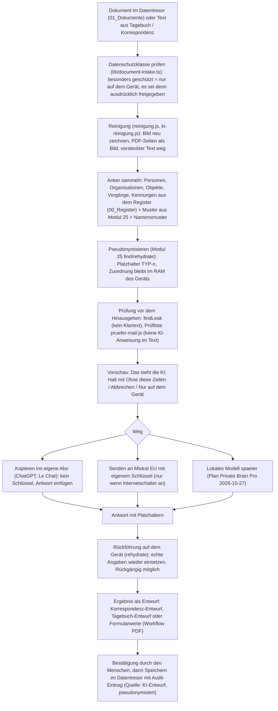

# Paket C · KI-Einsatz und Anonymisierung

Stand 28.10.2026. Alles hier ist im Code nachgesehen (Fundstellen mit Datei und Zeile; Commits der
gelesenen Klone am Ende). Keine echten Daten. Andere Repos wurden nur gelesen.

## 1. Kurzfassung

1. **Die Familienakte hat heute keine KI-Schnittstelle.** Kein `fetch` an einen KI-Anbieter, kein
   Schlüssel, kein lokales Modell. „Mit ChatGPT arbeiten“ ist ein Zwischenablage-Weg
   (`app/health-portal.tsx:3344–3362`), die Recherche in der Assistenz ist fest `not_configured`
   (`lib/family-assistant.ts:124`). Der einzige `fetch` in der App lädt eine Datei aus dem eigenen
   Dateieingang (`app/health-portal.tsx:687`).
2. **„Anonymisierung“ gibt es nicht, nur Anzeige-Maskierung.** `lib/family-privacy.ts` und
   `lib/family-cockpit.ts:113` verbergen Gesundheitsangaben in Übersichten per Wortmuster. Kein
   Platzhalter, keine Zuordnungstabelle, keine Rückführung, keine Prüfung vor dem Hinausgehen.
3. **„Für den Assistenten freigeben“ ist eine Archiv-/Registerfunktion, keine KI-Freigabe.**
   `releaseInventoryItemsForAssistant` (`app/local-vault.ts:2323`) legt aus einer geprüften Archivkopie
   einen Dokumentdatensatz im Register an und setzt den Zustand `ASSISTENZ_FREIGEGEBEN`. Danach darf der
   regelbasierte Assistent (`lib/family-assistant.ts:86–89`) den **Titel** des Dokuments als
   „Aktenhinweis“ anführen. Es verlässt nichts das Gerät.
4. **Klaus' Vermutung (anonymisieren → KI füllt aus → zurückführen) ist in der Familienakte nicht
   vorbereitet, aber in den anderen Repos weitgehend gebaut und getestet:** Modul 25 (Pseudonymisierung
   mit Rückführung, byte-gleich in Private Brain Pro, V3, Privat-Brain, Sende-Prüfer), BookLedgerPro
   (Anker, Muster, Namensmuster, Vorschau „Das sieht die KI“, Halt bei KI-Anweisung, Rückführung nur auf
   dem Gerät), Workflow PDF (Formularfelder erkennen und ausfüllen, AcroForm-Ausgabe, KI nur für die
   Felderkennung), Prüfliste `pruefer-mail.js` und Reinigung `reinigung.js` (versteckter Text, Metadaten).
5. **Empfehlung:** das KI-Schloss aus BookLedgerPro / Private Brain Pro übernehmen (Modul 25 + Prüfliste +
   Reinigung byte-gleich, dazu ein kleiner Klebstoff für die Familienakte), nichts Eigenes erfinden.
   Details und Dateiliste in Abschnitt 6.

## 2. Die Familienakte: alle Stellen mit KI-Bezug

| Stelle | Fundstelle | Was heute wirklich passiert | Netz? |
| --- | --- | --- | --- |
| „Mit ChatGPT arbeiten“ (Startseite, Fußzeile „Unterstützung“, Cockpit) | `app/health-portal.tsx:895`, `:1221`, `:3344–3362` (`ChatGPTEditDialog`) | Baut aus dem Wunschtext einen Auftrag „Nimm die folgenden Änderungen an [Me, Myself and I – Meine Familienakte](…) vor“, kopiert ihn in die Zwischenablage und öffnet `https://chatgpt.com/` in einem neuen Tab. Der Auftrag enthält **nur den eingetippten Wunsch**, keine Aktendaten. Feiner Text: „Hier wird keine OpenAI-API verwendet.“ | nur der Tab-Aufruf, keine Daten |
| Assistenzzentrale (A Akte · B Recherche · C Einschätzung) | `lib/family-assistant.ts:66–151`, `app/assistant-center.tsx:129` | `buildAssistantAnalysis` ist **Regelwerk**: Wortüberschneidung (`overlapScore`), Verknüpfungsnetz bis 3 Stufen, feste Sätze je Lage (`appointment`, `legal`). Karte „B · Aktuell recherchiert“ trägt dauerhaft den Hinweis „Nicht eingerichtet“ (`research.status = "not_configured"`, `:124`). | nein |
| Korrespondenz-Entwürfe | `lib/family-assistant.ts` (`buildCorrespondenceDraft`), Selbsttest `:195` | Textbausteine nach Art und Ton; Selbsttest prüft, dass im Quelltext kein `fetch(` steht („Entwürfe werden nicht automatisch versendet“). | nein |
| Tagebuch-Strukturierung (Tatsachen, Beobachtungen, Rückfrage) | `lib/family-memory.ts`; Hilfetext `app/health-portal.tsx:2147` | Lokale Regeln; Hilfetext sagt ausdrücklich „keinen kostenpflichtigen API-Schlüssel“. | nein |
| Suche „Verstanden als:“ | `lib/family-search.ts`; Hilfetext `:2152` | Themenlisten (Krankenkasse, Leistung, Schreiben, Ärzte, ICD, Aufgaben, Fristen). | nein |
| Freigabe für den Assistenten | `app/local-vault.ts:2323–2366`, Zustände `lib/fawoga-inventory.ts:7`, Zähler `app/local-vault.ts:2473–2474` | Nur für Bestandsdateien aus „Bestand prüfen“, die vorher archiviert wurden: Archivkopie per SHA-256 gegen Quelle und Archiv geprüft, Dokumentdatensatz in `01_Dokumente/<Lebensbereich>/` angelegt oder wiederverwendet, zwei Speicherorte vermerkt, Audit-Eintrag „Bestandsdokument für Assistenz freigegeben“. Folge: `assistantReleased: true` am Dokument (`app/health-portal.tsx:1174`), damit der Assistent es als Aktenhinweis nennen darf (`lib/family-assistant.ts:86`). Nicht freigegebene Dokumente landen in `excludedDocumentIds`. | nein |
| Datenschutzklassen `allgemein / vertraulich / besonders geschützt` | `lib/document-intake.ts:27, 44–64` | Werden beim Eingang aus dem **Dateinamen** (Schlüsselwörter) vergeben: Gesundheit, Vorsorge, Finanzen/Behörde → „besonders geschützt“; Technik → „allgemein“; Rest „vertraulich“. Sie steuern die Vorschau (`sensitive`, `:120`) und erscheinen im Zuordnungsdialog (`app/health-portal.tsx:3444`). Keine Wirkung auf einen KI-Weg, weil es keinen gibt. | nein |
| Maskierung von Gesundheitsangaben | `lib/family-privacy.ts:1–30`, `lib/family-cockpit.ts:113, 189` | Wortmuster (`gesund|arzt|…|rente|behörd|finanz|bank|persönlich`), ersetzt Beschriftungen durch „Geschützte Gesundheitsunterlage“; `buildSensitiveIds` vererbt über Verknüpfungen. Das ist Anzeige-Schutz innerhalb der App, kein Schutz vor dem Hinausgehen. | nein |
| Systemprüfung: pausierte Fähigkeiten | `lib/system-check-manifest.json:101–105` | „OneDrive-Automatik“, „automatische Dateiverschiebung“, „kostenpflichtige APIs“ sind bewusst pausiert. | – |
| Versionshistorie | `app/health-portal.tsx:2851–2866` | Mehrfach „kein kostenpflichtiger OpenAI-API-Schlüssel eingebaut“, „keine externe KI-Suche aktiviert“. Die Absicht des Freundes: KI später, aber ausdrücklich ohne Abo-Schlüssel in der App; ChatGPT über das eigene Konto. | – |
| Diktat | `lib/browser-dictation.ts` | Web Speech API; Hilfetext `:2171`: „Je nach Browser kann die Spracherkennung über den Dienst des Browseranbieters verarbeitet werden.“ Das ist der **einzige Weg, auf dem heute Inhalt das Gerät verlassen kann** (Sprache an Google/Apple/Microsoft, je nach Browser). | ja, Browser-Dienst |

**Fazit zu Punkt 1 des Auftrags:** Heute passiert nichts mit KI. Vorbereitet sind drei Dinge: die
Datenschutzklasse je Dokument, die Freigabe-Marke `assistantReleased` und eine Assistenz-Oberfläche mit
drei Spalten, deren mittlere („Aktuell recherchiert“) auf eine spätere Anbindung wartet. Ein Datenfluss
„anonymisieren → KI → zurückführen“ existiert nicht, auch nicht als Stub.

## 3. Die anderen Repos: Bausteine mit Fundstellen

Legende Reifegrad: ○ nicht vorhanden · ◔ Idee/Text · ◑ Teil-Code · ◕ funktionsfähig · ● getestet (Node/Browser-Probe im Repo).

### 3.1 Private Brain Pro (`Privat-Brain-Pro` b0a28dd, V3 `privat-brain-pro-v3` 1b4a6c9, Privat-Brain a3e0f7a stillgelegt)

| Baustein | Datei | Reife | Befund |
| --- | --- | --- | --- |
| Pseudonymisierung mit Rückführung | `modules/25_pseudonym.js` (473 Zeilen, SHA-256 `8c3092ba…`, **byte-gleich** in Pro, V3, Privat-Brain und Sende-Prüfer) | ● | Platzhalter `⟦TYP-n⟧` für SCHLUESSEL, MAIL, TELEFON, IBAN (Prüfziffer), BETRAG, RECHNUNG, DATUM; Namen über `values`; `find()` liefert Fundstellen mit Lage, `rehydrate()` setzt die echten Angaben wieder ein, `findLeak()` prüft, ob noch Klartext aus der Zuordnung im Text steht („die letzte Sicherung vor dem Hinausgehen“). Zuordnung bleibt beim Aufrufer. |
| KI beim Schreiben (Mail) | `native/native-mail-ai.js` (182 Zeilen), `docs/KI-BEIM-SCHREIBEN.md` | ● (18 Prüfungen, Mistral gestellt) | Gegenlesen/Entwurf, „Das sieht die KI“, Senden an Mistral (EU) mit Schlüssel, „Verdeckten Text kopieren“ fürs eigene Abo, „In die Mail übernehmen“ = Rückführung mit Rückgängig. Zusätzlich: Namen aus An/Cc/Bcc und Zitatzeilen, Telefon mit Leerzeichen, eigene Liste, markierter Text. Kein Senden, solange `findLeak` etwas findet. Anhänge nie. |
| Reinigung vor der KI (Bilder, PDF) | `modules/reinigung.js` (byte-gleich aus Workflow PDF, SHA `c3420fb5…`), `modules/ki-reinigung.js` (262 Zeilen) | ● (`e2e-ki-reinigung` 44 grün) | Bilder nur neu gezeichnet (EXIF/GPS weg), PDF-Seiten als Bild mit zugedecktem verstecktem Text, PDF-Text ohne unsichtbare Stücke, einmal anhalten je Sendevorgang. |
| Prüfliste KI-Anweisung | `modules/pruefer-mail.js` (973 Zeilen, SHA `cdf3ca78…`, byte-gleich aus dem Auslieferungsprüfer) | ● | Feste Wendungen DE/EN; ohne Liste läuft kein KI-Richter; Text mit Anweisung an eine KI geht nicht hinaus. |
| Schlüssel | `native/native-keys.js`, Einstellungen | ◕ | Mistral-/Google-Schlüssel in der App-Einstellung (Pro-App: Keystore-gestützt über native Brücke; PWA: Browser-Speicher). Links „Schlüssel holen“. |
| Lokale Modelle (Embedding, Übersetzung, Bild) | `native/native-semantic.js`, `docs/PLAN_2026-10-27_ANALYSE-MODELLE-SORTIERUNG-KI.md` | ●/◔ | e5-small lokal (gebaut), Plan für Whisper/größere Modelle und lokale KI mit Auftragsfeld (nur Plan, nicht bauen ohne Klaus). |
| Werkzeuge einladen | `native/native-tools.js` (224 Zeilen), `docs/WERKZEUGE-UND-FREISCHALTUNG.md` | ● | Mitgelieferte Tools laufen im App-Fenster (`apps/<dir>/`, unverändert kopiert, SHA in `apps/SOURCES.json`); ein „Download“ eines Tools wird abgefangen und der App zum Einlesen angeboten. Fremde Apps (Workflow PDF Pro) werden nativ gestartet. |

### 3.2 BookLedgerPro (`bookledgerpro` f6633c8, privat)

| Baustein | Datei | Reife | Befund |
| --- | --- | --- | --- |
| Tokenize/Reidentify | `src/ai/pseudonym.js` (232 Zeilen) | ● (node) | Generation 1 des Modul-25-Prinzips: exakte Anker → stabile Token `[[TYP_N]]`, Round-Trip-Garantie, `maskierungsBericht`. |
| Anker aus Stammdaten | `src/ai/anker.js` (156) | ● | Kunden, Mitarbeiter, Firma, IBAN, USt-IdNr, Steuernummer, „Weitere Namen“, „Nie verdecken“. |
| Muster für Fremd-PII | `src/ai/ner.js` (136) | ● | E-Mail, IBAN, USt-IdNr, Steuernummer, Telefon mit Trenner; bewusst konservativ, kein BIC. |
| Namen nach Muster | `src/ai/namensmuster.js` (157), `namensvorschlag.js` (37) | ● (`smoke_handnamen` 21) | Anrede, Kontext („z. Hd.“, „Inhaber“), Vor- + Nachname, Firma mit Rechtsform; Treffer gelb sichtbar, Rücknahme per Tipp, „Nie verdecken“. |
| Hierarchie (Mandant ⊃ Firma ⊃ Person) | `src/ai/briefkasten.js` (197) | ● | Scope-Präfixe in den Token, damit die KI Zusammengehöriges erkennt, ohne Namen zu sehen. |
| Vorbereitung Bild/PDF | `src/ai/kiVorbereitung.js` (209) | ● | Wie `ki-reinigung.js`: Seiten gezeichnet, versteckter Text zugedeckt, 300 dpi/JPEG 92 % gemessen. |
| Halt bei KI-Anweisung | `kiTextFreigabe` (`src/domain/belegPruefung.js`, Prüfliste) | ● | Vor jeder Weitergabe; „Ohne diese Zeilen“ / „Nur auf dem Gerät“. |
| Frage an die Belege (A3) | `src/ui/views/belege.js`, `CLAUDE.md` Abschnitt „Frage an die Belege“ | ● (`smoke_frage` 16, Mistral gestellt) | Höchstens 5 Belegtexte pseudonymisiert → Halt → Vorschau „Das sieht die KI“ → Senden → `reidentify` nur auf dem Gerät, Antwort mit Belegverweisen `[n]`. **Das ist der vollständige Fluss, den Klaus vermutet**, nur mit „Frage beantworten“ statt „Formular ausfüllen“. |
| KI-Anbindung, Schlüssel | `src/ai/aiConfig.js` (verschlüsselt mit Sitzungsschlüssel im Tresor), `src/ai/anbieter.js` (strikt EU), `src/ai/mistral.js`, `vision.js`, `mistralOcr.js` | ◕/● | Mistral EU (Chat), Google Vision EU (OCR), Google Speech EU; alles BYOK, opt-in, Heuristik als Rückfall. „Nicht gegen die Live-API getestet“ steht ehrlich im Kopf. |
| Übergabe-Verträge | `docs/UEBERNAHME_TOMY.md` (v1 `?uebernahme=`, v2 „Vorgang“ mit `verweise`), `manifest.webmanifest:18` (`share_target`: PDF, Bilder, `.eml`), `docs/MAIL-TEILEN.md`, `docs/WORKFLOW-PDF-EINBINDUNG.md` (Weg 3: `*.workfloh.json` hin, unterschriebenes PDF zurück), `docs/design/PLAN-TRESORORDNER-2026-10-26.md` (Fächer `Eingang-BookLedgerPro/`, `Eingang-WorkflowPDF/`, Marke „übernommen“) | ● | Siehe Abschnitt 7. |
| Werkzeuge einbetten | `docs/APPS-CALCULATE-NEEDS.md`, `apps/`, `tools/apps-nachziehen.mjs` | ● | Calculate und Needs laufen 1:1 im Rahmen (`#blp-app-frames`), Übergabe per `postMessage`/Haken statt Seitenwechsel. |

### 3.3 Workflow PDF (`workflow-pdf` a2cfdf1) und Workflow PDF Pro (`workflow-pdf-pro` c85234e)

| Baustein | Datei | Reife | Befund |
| --- | --- | --- | --- |
| Formularfelder erkennen (offline) | `assets/erkennung.js` | ● | Linien, Rahmen, Kästchen im Seitenbild; Beschriftung aus dem Text daneben. |
| Formularfelder erkennen (KI) | `assets/erkennung.js:231–233, 267–268, 284–303` | ◕ (KI gestellt geprüft) | Mistral pixtral (EU), Anthropic, OpenAI mit eigenem Schlüssel; die KI liefert Bezeichnungen, Seitentext und ob ein Feld schon Inhalt hat. **Das Seitenbild geht hinaus** (gereinigt nach `reinigung.js`), nicht die Antworten des Nutzers. |
| Ausfüllen | App selbst | ● | Der Mensch füllt auf der Seite aus; keine KI füllt Werte ein. |
| AcroForm-Ausgabe | `assets/export.js:103–209` (`pdf.getForm()`, `createTextField`, `acroForm.dict`) | ● | Festes PDF, ausfüllbares PDF (vorbelegt), leere ausfüllbare Vorlage. |
| Reinigung | `assets/reinigung.js` (Ursprung, byte-gleich in PBP) | ● (`tests/reinigung.mjs`) | Versteckter Text, Metadaten; entfernter Text wird mit dem Dokument gespeichert. |
| Übersetzen in Lage des Originals, Behördenformulare | README „🌐 Übersetzen“, „🏛️ Behördenformulare“ | ● | Felder im Original setzen → übersetzt an gleicher Stelle → zurück ins Original. |
| Schlüssel | README „Grenzen“ | ◑ | „Der KI-Schlüssel liegt unverschlüsselt im Speicher des Browsers.“ Pro-Fassung: Tresor/Keystore. |
| Pro: Tresorordner-Paket | `native/native-tresorordner.js`, `docs/TRESORORDNER.md` | ● | Pflege des gemeinsamen Pakets `de.familyprojekt.tresor` (Kopf `tresorordner.json`, Fächer, Marken). |

Es gibt **keine** Stelle, an der eine KI ein Formular mit Nutzerdaten ausfüllt. „KI füllt aus“ gibt es nur als
Erkennung der Felder und des schon Gedruckten.

### 3.4 Sende-Prüfer (`sende-pruefer` 5ec235d) und Sendeprüfer Made GPT (`sendepruefer-made-gpt` 0be5d66)

| Baustein | Datei | Reife | Befund |
| --- | --- | --- | --- |
| Postfach mit Verdeckung vor der KI | `sende-pruefer.html`, `assets/postfach.js`, `modules/25_pseudonym.js` (byte-gleich) | ● (`PROBE.md`, Köder `koeder.txt`) | Mail einfügen oder `.eml`, Namen aus Von/An/Cc verdeckt, „Weitere Namen“, „Was die KI sieht“, Kopieren oder Senden (Claude erprobt; ChatGPT, Gemini, OpenRouter, Mistral nach Unterlagen), Antwort mit echten Angaben zurück, `.eml` speichern/teilen. **Das ist die Ursprungs-App des Modul-25-Kerns** („der Kern soll ein eigenes Modul sein in Sage“). |
| Schlüsseltresor | `assets/schluesseltresor.js` | ● | AES-256, 600 000 Runden, Code. |
| Anhangprüfung | `assets/anhaenge.js`, `pruefer-anhang.js`, `pruefer-formate.js` | ● | Metadaten, Skripte, Makros, falsche Endung; Text aus SVG/Office an den Prüfkern; OCR auf dem Gerät; keine Datei an die KI. |
| Abschirmung | `assets/abschirmung.js` | ● | Hält Browser-Schreibhilfen (Grammarly, LanguageTool) fern. |
| GPT-Fassung v1.1.0 | `assets/inhaltspruefung.js`, `Uebergabe-Sendepruefer-GPT-v1.1.0.md` | ◕ (241 Node-Prüfungen, Browser ungeprüft) | Inhaltsprüfung auf KI-Anweisungen (Unicode-Prüfkopie, Base64), Freigabe mit bewusstem Haken, Schutzinstruktion im Systemkanal. ZIP „noch nicht veröffentlicht“. |

**Antwort auf die Frage „Ausgangskontrolle?“:** Ja. Der Sende-Prüfer ist genau die Kontrolle *vor der
KI*: `findLeak` (Modul 25) verweigert das Senden, solange ein Klartext aus der Zuordnung im Text steht,
und die Prüfliste hält bei Anweisungen an eine KI an. Was er **nicht** kann: Adressen, Kennzeichen,
Gesundheitsangaben ohne Muster (LIESMICH „Grenzen“ 1–5). Deshalb immer „Was die KI sieht“ lesen.

### 3.5 Auslieferungsprüfer (`auslieferung-pruefer` 6909ab1) und Auslieferungsprüfer GPT (`auslieferungspruefer-made-gpt` 899aa8e)

| Baustein | Datei | Reife | Befund |
| --- | --- | --- | --- |
| Prüfkern für Seiten, Dateien, Mails, PDF | `assets/pruefer.js`, `pruefer-mail.js` (Ursprung der Prüfliste), `pruefer-anhang.js`, `pruefer-formate.js`, `werkzeuge/pruefe-datei.py` | ● | Fremde Adressen, Server-Dateien, offene Schlüssel, **Personenbezug** (dieselben Muster wie Modul 25), KI-Anweisungen, versteckter PDF-Text, OCR, PNG-Bildpunkte (GPT-Fassung). Lädt nichts hoch. |
| Rolle für die Familienakte | – | – | Kontrolle *nach* dem Bau: prüft, was die ausgelieferte App ins Netz gibt (CDN-Nachladen wie pdf.js von cdnjs würde hier auffallen). Für den Datenfluss „vor der KI“ ist der Sende-Prüfer das Vorbild, der Auslieferungsprüfer liefert die Prüfliste. |

### 3.6 Kim-sync (`kim-sync` 1230cab)

Keine KI-Anonymisierung. Relevant: Bedeutungssuche mit Modul 03 (lokal), Diktat über Modul 21 (byte-gleich aus
Private Brain Pro), **Übersetzen auf dem Gerät** mit Chromes `Translator`/`LanguageDetector` ohne Cloud-Ersatz,
und das Neuzeichnen empfangener Bilder (Metadaten weg). Für Paket C nur als Beleg, dass „auf dem Gerät, sonst
nichts“ die Hausregel ist.

## 4. Reifegrad-Tabelle je Baustein

| Baustein | Familienakte | Private Brain Pro / V3 | BookLedgerPro | Workflow PDF (Pro) | Sende-Prüfer | Auslieferungsprüfer |
| --- | --- | --- | --- | --- | --- | --- |
| Erkennung personenbezogener Angaben (Muster) | ○ (nur Gesundheits-Wortmuster für die Anzeige) | ● Modul 25 | ● `ner.js` + Modul-25-Vorschläge | ○ | ● Modul 25 | ● Prüfkern |
| Exakte Anker aus eigenen Stammdaten | ○ | ◑ (Namen aus Mailfeldern, eigene Liste) | ● `anker.js`, `briefkasten.js` | ○ | ◑ „Weitere Namen“ | ○ |
| Namen ohne Muster (Anrede, Kontext) | ○ | ◑ Vorschläge | ● `namensmuster.js` | ○ | ◑ Vorschläge | ○ |
| Platzhalter + Zuordnungstabelle | ○ | ● | ● | ○ | ● | – |
| Rückführung nach der KI | ○ | ● (`rehydrate`, Rückgängig) | ● (`reidentify`) | ○ | ● | – |
| Leck-Prüfung vor dem Senden | ○ | ● `findLeak` | ● (Vorschau, Anker-Probe) | ○ | ● | ● (für Seiten) |
| Halt bei KI-Anweisung im Text | ○ | ● Prüfliste | ● `kiTextFreigabe` | ○ (nur Reinigung) | ● (GPT-Fassung: Inhaltsprüfung) | ● Ursprung |
| Reinigung Bild/PDF (Metadaten, versteckter Text) | ○ | ● | ● | ● Ursprung | ● Anhänge | ● |
| Vorschau „Das sieht die KI“ | ○ | ● | ● | ○ | ● | – |
| KI-Anbindung mit eigenem Schlüssel | ○ (ausdrücklich nicht gewollt: „ohne kostenpflichtige API“) | ● Mistral EU | ● Mistral EU, Vision EU, Speech EU | ◕ Mistral/Anthropic/OpenAI | ◕ fünf Anbieter | – |
| Weg ohne Schlüssel (Kopieren ins eigene Abo) | ◑ „Auftrag kopieren“ (ohne Aktendaten) | ● „Verdeckten Text kopieren“ | ○ | ○ | ● Kopieren | – |
| Lokales Modell (ohne Netz) | ○ | ● e5-small; Plan Whisper/LLM | ● e5-small | ○ | ○ | ○ |
| Formularfelder erkennen | ○ | ○ | ○ | ● offline, ◕ KI | ○ | ○ |
| Formular ausfüllen durch KI | ○ | ○ | ○ | ○ (Mensch füllt aus; KI liest nur Gedrucktes) | ○ | ○ |
| AcroForm/festes PDF ausgeben | ○ (nur eigene Beispiel-PDFs über `lib/sample-pdf.ts`) | ○ | ◕ (pdf-lib im Rundlauf) | ● | ○ | ○ |
| Schlüsselablage | – | ◕ App-Einstellung/Keystore | ● verschlüsselt mit Sitzungsschlüssel | ◑ unverschlüsselt (PWA) | ● Tresor mit Code | – |
| Übergabe-Verträge an andere Apps | ○ | ● Teilen `.eml` an BookLedgerPro, Tresorordner-Fach | ● v1/v2, `share_target`, Fächer, Rundlauf | ● `?scan=1&von=`, `*.workfloh.json` | ◑ `.eml` teilen | – |

## 5. Vorgeschlagener Datenfluss für die Familienakte

Grundsätze, die aus den anderen Repos übernommen werden sollten (alle dort schon Regel):

- „Liest nur · schlägt vor · bewegt nichts“: Die KI liefert Entwürfe, die Familienakte speichert erst nach
  Bestätigung (passt zu `buildCorrespondenceDraft` und den Tagebuch-Entwürfen).
- „Besonders geschützt“ geht **nie** hinaus, außer der Nutzer gibt genau dieses Dokument für genau diesen
  Vorgang frei. Die Marke `assistantReleased` lässt sich dafür wiederverwenden, muss aber dann eine echte
  Freigabe werden (heute ist sie eine Archivmarke).
- Internetschalter aus (Teil 2.1 des Baus) = kein KI-Weg außer Kopieren.
- Der Freund hat „ohne kostenpflichtige API“ wiederholt in die Versionshistorie geschrieben. Der
  **Kopieren-Weg** (wie in Private Brain Pro „Verdeckten Text kopieren“ und im Sende-Prüfer) erfüllt das
  und ist zugleich der kleinste erste Schritt; der Schlüssel-Weg bleibt opt-in.

## 6. Empfehlung: KI-Schloss aus BookLedgerPro / Private Brain Pro übernehmen

**Empfehlung: Ja**, aber nicht als Kopie der BookLedgerPro-Generation-1-Dateien (`src/ai/pseudonym.js`,
Token `[[TYP_N]]`), sondern über den **Kanon**, der ohnehin in vier Repos byte-gleich liegt: Modul 25.
BookLedgerPro liefert zusätzlich die zwei Bausteine, die Modul 25 nicht hat (Anker aus Stammdaten,
Namen nach Muster); die sind klein und reine Logik.

| Datei | Herkunft (Repo, Datei, Commit) | Übernahme |
| --- | --- | --- |
| `modules/25_pseudonym.js` | Privat-Brain-Pro b0a28dd `modules/25_pseudonym.js` (SHA-256 `8c3092ba…`, gleich in V3 1b4a6c9, Privat-Brain a3e0f7a, Sende-Prüfer 5ec235d) | **byte-gleich**, Herkunft im Kopf der Kopie vermerken, SHA in einer Probe pinnen |
| `modules/pruefer-mail.js` | Privat-Brain-Pro b0a28dd (SHA `cdf3ca78…`), Ursprung Auslieferungsprüfer | **byte-gleich** |
| `modules/reinigung.js` | Workflow-PDF a2cfdf1 `assets/reinigung.js` (SHA `c3420fb5…`, gleich in PBP) | **byte-gleich** |
| `modules/ki-reinigung.js` | Privat-Brain-Pro b0a28dd | byte-gleich, wenn pdf.js lokal im Paket liegt (`window.KI_REINIGUNG_PDFJS` auf den eigenen Pfad setzen, kein CDN) |
| `src/ai/namensmuster.js`, `src/ai/ner.js` | bookledgerpro f6633c8 | byte-gleich (reine Logik, keine Abhängigkeit außer `ANKER_TYP`); **Achtung**: BookLedgerPro liefert `[[TYP_N]]`-Anker an `tokenize`, Modul 25 nimmt Namen über `values`. Klebstoff übersetzt. |
| `lib/ki-schloss.ts` (neu, Klebstoff) | Familienakte | Anker aus dem Register bauen (Personen `displayName`, Organisationen, Objekte mit Kennungen, Vorgangstitel, Versicherungs-/Vertragsnummern aus den Datensätzen), `find`/`rehydrate` aufrufen, Leck- und Anweisungsprüfung, Ergebnis an die Oberfläche. Reine Funktionen, Node-Probe wie `scripts/run-*.mjs`. |
| `app/ki-vorschau.tsx` (neu) | Familienakte | Dialog „Das sieht die KI“ im Stil der vorhandenen Modale (`modal-backdrop`, `edit-dialog`), Knöpfe Kopieren / Senden / Abbrechen, Rückführung „In den Entwurf übernehmen“ mit Rückgängig. Wortlaut und Aufbau wie `ChatGPTEditDialog`, damit die Oberfläche des Freundes gleich bleibt. |
| Anbindung | `native-network.js` (Teil 2.1) | Senden nur bei Internet an; Kopieren immer. Mistral-Route wie `native/native-mail-ai.js` (nur verdeckter Text, nur der Schlüssel des gewählten Anbieters). |

**Aufwand:** 2 Sitzungen. Sitzung 1: Module kopieren und pinnen, `lib/ki-schloss.ts` mit Node-Proben
(Anker aus Beispielfamilie, Round-Trip, Leck, Anweisung), Kopieren-Weg im Korrespondenz-Entwurf und im
ChatGPT-Dialog (Aktendaten dürfen erst mit Vorschau hinein). Sitzung 2: Schlüssel-Weg (Mistral EU) mit
Einstellung, Internetschalter-Kopplung, Freigabe „besonders geschützt“ je Vorgang, Playwright-Probe mit
gestellter KI, Gegenprobe (Anker weg → rot, Halt weg → rot, Rückführung weg → rot).

**Risiken:**

- Modul 25 erkennt keine Adressen, Kennzeichen oder Gesundheitsangaben ohne Muster. Die Familienakte hat
  aber genau diese Daten. Gegenmittel: Anker aus dem Register (alles, was die App als Datensatz kennt, ist
  ein exakter Anker) plus Namensmuster; trotzdem bleibt die Vorschau Pflicht.
- Die Zuordnung lebt nur im RAM; ein Seitenwechsel während der KI-Antwort verliert sie. Private Brain Pro
  bindet sie an die offene Mail; hier an den offenen Entwurf.
- Beispieldaten müssen unverändert erfunden bleiben; die Probe darf nur die Familie Lindqvist-Arenberg nutzen.
- Der Freund wollte keine Abo-Schlüssel in der App. Der Schlüssel-Weg muss deshalb klar als freiwilliger
  zweiter Weg erscheinen, im Wortlaut seiner Hilfe („ohne kostenpflichtige API“ bleibt für den Kopieren-Weg wahr).
- pdf.js kommt heute von cdnjs (`app/file-viewer.tsx`); für `ki-reinigung.js` und für Offline muss es ins Paket
  (gehört ohnehin zu Teil 2.1).

**Nicht empfohlen:** Eine eigene Anonymisierung in TypeScript neu schreiben. Die Muster stehen bereits
zweimal (Modul 25 und Auslieferungsprüfer) und sind per Köder geprüft; eine dritte Fassung läuft auseinander.

## 7. Klaus' Zusatz: Werkzeuge einladen, Daten übergeben und zurück

Vorhandene Verträge, an die die Familienakte andocken kann, ohne etwas neu zu erfinden:

| Vertrag | Wo | Richtung | Für die Familienakte |
| --- | --- | --- | --- |
| **Teilen-Ziel** (`share_target`, Android-Intent `ACTION_SEND`) | BookLedgerPro `manifest.webmanifest:18` (PDF, Bilder, `.eml`), Private Brain Pro `ProSharePlugin`, Workflow PDF Pro `native-incoming.js` | Datei **hin** zu einer App | Familienakte als Teilen-Ziel (PWA `share_target`, APK Intent) und als **Absender**: „An BookLedgerPro teilen“ / „An Workflow PDF Pro“ über `navigator.share({files})` bzw. Intent mit `message/rfc822` / `application/pdf`. Dateieingang mit Zuordnungsvorschlag bleibt derselbe. |
| **Datenvertrag v1/v2 „Vorgang“** (`?uebernahme=<base64url(JSON)>`, `art`, `quelle`, `verweise`) | BookLedgerPro `docs/UEBERNAHME_TOMY.md`, `src/domain/uebernahmeExtern.js` | Strukturierte Daten **hin** (Angebot, Summen) und Stand **zurück** (`art: 'status'`) | Ein Vorgang der Familienakte (z. B. Garantiefall mit Rechnung) könnte als `quelle: 'familienakte'` an BookLedgerPro gehen; BookLedgerPro müsste die Quelle freischalten (`UEBERNAHME_QUELLEN`, Änderung dort). Rückweg: Stand „Rechnung erstellt / bezahlt“ als Notiz am Vorgang. Nur mit Klaus' Wort, weil es das andere Repo berührt. |
| **Scanner-Direktstart** (`?scan=1&von=<App>`) | Workflow PDF (Kern 1.1.1), Workflow PDF Pro `native-incoming.js` | Werkzeug **einladen**, PDF **zurück** per Teilen | „Dokument fotografieren“ der Familienakte bleibt; zusätzlich „Mit Workflow PDF scannen“ (PWA: Link mit `von=Familienakte`, APK: Paket starten), Rückgabe als Teilen → Familienakte. Marke „Workfloh PDF · Scannen“ = eigener Scan. |
| **Arbeitsstand-Rundlauf** (`*.workfloh.json` + PDF hin, festes PDF zurück, Marke in Keywords) | BookLedgerPro `docs/WORKFLOW-PDF-EINBINDUNG.md` Weg 3, `src/domain/workflowPdfRundlauf.js` | Formular **hin**, ausgefüllt **zurück** | Das ist der Weg für „Formular ausfüllen“: die Familienakte legt Felder (Name, Adresse, Vorgangsnummer aus dem Register) in die Arbeitsstand-Datei, Workflow PDF füllt sie an den Linien, zurück kommt das feste PDF in den Dateieingang und wird dem Vorgang zugeordnet. Ohne KI; mit KI nur über das Schloss aus Abschnitt 6. |
| **Gemeinsamer Tresorordner, Fächer `Eingang-<App>/`** (Paket `de.familyprojekt.tresor`, PBV1-Schloss, Marke „übernommen“) | Workflow PDF Pro `native/native-tresorordner.js`, BookLedgerPro `docs/TRESORORDNER.md`, Private Brain Pro `docs/TRESORORDNER.md` | Dateien in beide Richtungen, nativ (Android/Windows) | Fach `Familienakte/` und `Eingang-Familienakte/`; die Familienakte liest das Eingangsfach wie heute den lokalen Eingangsordner (`scanLocalInbox`) und schreibt Übergaben in `Eingang-BookLedgerPro/` bzw. `Eingang-WorkflowPDF/`. Entscheidung „eigener Tresor oder gemeinsamer“ ist offen; für den ersten Bau eigener Tresor (Brief). |
| **Werkzeuge im App-Fenster** (`apps/<dir>/` 1:1 kopiert, `postMessage`-Brücke, Vorrat zum Offline-Bereitlegen) | BookLedgerPro `docs/APPS-CALCULATE-NEEDS.md`, Private Brain Pro `native/native-tools.js` | Werkzeug **eingeladen**, Daten über Haken **zurück** | Entspricht Klaus' „Tools zusätzlich einladen, Daten nur übergeben und wieder zurück“ am genauesten: Werkzeug läuft im Rahmen, speichert in seiner eigenen Ablage, die Familienakte bekommt nur das Ergebnis (Datei oder JSON). Für den Sende-Prüfer wäre das der schnellste Weg zu einem KI-Postfach mit Schloss: Sende-Prüfer 1:1 einbetten, `.eml` aus der Korrespondenz übergeben, Antwort-`.eml` zurück in den Dateieingang. |
| **E-Mail-Übergabe** („An BookLedgerPro teilen“ legt `.eml` ins Fach oder teilt sie) | Private Brain Pro `assets/live-mail.js` (Schlüssel `bookledger`), BookLedgerPro `docs/MAIL-TEILEN.md` | `.eml` **hin** | Die Familienakte liest `.eml` mit Anhängen schon (`extractEmlAttachments`). Ein eigenes Postfach wie Private Brain (IMAP/SMTP nativ) ist ein eigener Bau (siehe Plattformen-Papier); das Teilen einer `.eml` an BookLedgerPro geht sofort über den Teilen-Weg. |

**Bewertung:** Für den ersten Schritt reicht „Werkzeuge einladen“ ohne neue Verträge: Teilen-Ziel in beide
Richtungen (Dateien), Scanner-Direktstart (Workflow PDF), und der Sende-Prüfer als eingebettetes Werkzeug
für den KI-Weg mit Schloss. Strukturierte Übergaben (Vorgang v2, Tresorordner-Fächer) brauchen Änderungen in
den anderen Repos oder die Tresorordner-Entscheidung und gehören in eine spätere Sitzung mit Klaus' Wort.

## 8. Offene Fragen an Klaus / den Freund

1. KI-Weg zuerst nur **Kopieren** (ohne Schlüssel, wie die Hilfe des Freundes es beschreibt) oder gleich
   auch **Senden mit Mistral EU**?
2. Darf ein Dokument der Klasse „besonders geschützt“ überhaupt je pseudonymisiert hinausgehen, oder bleibt
   diese Klasse immer auf dem Gerät?
3. Sende-Prüfer als eingebettetes Werkzeug (1:1, eigene Ablage) oder das Schloss direkt in die Familienakte
   (Abschnitt 6)? Beides zusammen ist möglich: erst Werkzeug, später Schloss.
4. Soll die Marke „für den Assistenten freigegeben“ ihre heutige Bedeutung (Archiv → Register) behalten oder
   zur echten KI-Freigabe werden? Das ändert den Wortlaut der Hilfe (`app/health-portal.tsx:2137`).

## Gelesene Stände

| Repo | Commit |
| --- | --- |
| Meine-Familienakte | `main` 22d0b40 |
| Privat-Brain-Pro | b0a28dd |
| Privat-Brain-Pro-V3 | 1b4a6c9 |
| Privat-Brain (stillgelegt) | a3e0f7a |
| BookLedgerPro | f6633c8 |
| Kim-sync | 1230cab |
| Workflow-PDF | a2cfdf1 |
| Workflow-PDF-Pro | c85234e |
| Sende-Pruefer | 5ec235d |
| Sendepruefer-Made-GPT | 0be5d66 |
| Auslieferung-Pruefer | 6909ab1 |
| Auslieferungspruefer-Made-GPT | 899aa8e |
