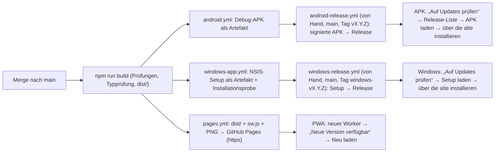

# Paket F: Mikrofon-Auswahl und Plattformen (PWA, APK, Windows, Aktualisierung)

Stand 28.10.2026. Alles Nachgelesene ist mit Fundstelle versehen (Repo, Datei). Vorlagen-Repos wurden nur gelesen:
Privat-Brain-Pro `b0a28dd`, BookLedgerPro `f6633c8`, Workflow-PDF-Pro `c85234e`, Kim-sync `1230cab`.
Nichts davon ist am Gerät gemessen; was „gemessen“ heißt, steht ausdrücklich dabei.

## F1 · Mikrofon-Auswahl

### Ist-Stand in der Familienakte

| Was | Befund | Fundstelle |
| --- | --- | --- |
| Diktat | Web Speech API des Browsers (`SpeechRecognition` bzw. `webkitSpeechRecognition`), `lang = "de-DE"`, `continuous`, Neustart nach `onend` alle 250 ms, Fehlertexte „Mikrofonzugriff verweigert – bitte tippen.“ usw. | `lib/browser-dictation.ts` `createDictationSession` |
| Knöpfe | Ein `DictationButton` hinter jedem `VoiceInput`/`VoiceTextarea` (Suche, Tagebuch, Korrespondenz, Formulare); Symbol `Mic`/`MicOff` | `app/ui-controls.tsx` Zeilen 27–77 |
| Sperre | `microphoneBlockedReason()` deaktiviert den Knopf bei `isSecureContext === false` (lokale Datei, `content://` auf dem Handy) und bei entzogener Berechtigungsrichtlinie (eingebettete Seite, claude.ai) | `lib/browser-dictation.ts` Zeile 100 |
| Mikrofon-Wahl | **keine**: kein `enumerateDevices`, kein `deviceId`, kein `getUserMedia` im ganzen Repo (`grep` über `app/` und `lib/`: 0 Treffer) | – |
| Sprache | fest `de-DE`, keine Sprachwahl je Feld | `lib/browser-dictation.ts` Zeile 47 |

### Wie der Freund heute unter Windows das Mikrofon wählt

Die Web Speech API nimmt immer das Mikrofon, das der Browser bekommt, und der nimmt das Windows-Standardgerät:

1. **Windows:** Einstellungen → System → Sound → Eingabe → Gerät wählen. Wechselt Windows selbst (Bluetooth-Headset
   verbindet sich, USB-Mikrofon wird eingesteckt), wechselt das Diktat mit. Genau dieser Befund stand in Private Brain Pro
   (`Privat-Brain-Pro/docs/MIKROFON-WAHL-WINDOWS.md`, Abschnitt „Ursache“).
2. **Chrome/Edge je Website:** Schloss-Symbol in der Adresszeile → Website-Einstellungen → Mikrofon → Gerät. Das gilt pro
   Adresse (also pro Familienakte-Adresse) und überlebt den Neustart. In Chrome/Edge ab Version 135 kann eine Seite der
   Spracherkennung zusätzlich eine eigene Audiospur geben (Chrome-135-Release-Notes, in Private Brain Pro als PWA-Weg gebaut).
3. **Firefox** hat keine Spracherkennung; dort bleibt nur Tippen (festgehalten in KimHub `forschung/familienakte/`).

### Was eine Auswahl **in der App** bräuchte

| Baustein | Browser (PWA) | Android-App | Windows-App |
| --- | --- | --- | --- |
| Liste der Mikrofone | `navigator.mediaDevices.enumerateDevices()`; Namen erst nach einer Mikrofon-Freigabe (`getUserMedia`) | `AudioManager.getDevices(GET_DEVICES_INPUTS)` (Private Brain Pro `ProSpeechPlugin.inputs`) | SAPI-Aufzählung der Aufnahmegeräte (Private Brain Pro `windows/src-tauri/src/speech.rs`) |
| Gerät festlegen | `getUserMedia({ audio: { deviceId: { exact } } })` → `MediaStreamTrack` → `recognition.start(track)` (nur Chrome/Edge ≥ 135; ältere Browser ignorieren das) | Audio-Weiche `setCommunicationDevice` (ab Android 12) bzw. `startBluetoothSco`, nur `MODIFY_AUDIO_SETTINGS`, keine Aufnahme | SAPI `SetInput` mit genau diesem Gerät |
| Erkennung | Browser-Erkennung (Audio geht an den Browser-Hersteller) oder ein Dienst, der Audio annimmt (lokal: Whisper; EU: Mistral/Google EU wie in BookLedgerPro `src/ai/speech.js` „Engine EU“) | Androids Sprachfenster (`RecognizerIntent`), offline bevorzugt | SAPI (lokal, kein Netz) |
| Speicherung der Wahl | `localStorage` Kennung + Name (Private Brain Pro `pb_microphone_v1`); Wiederfinden über den Namen, weil die Kennung wechselt | gleich | gleich |
| Fehlerverhalten | gewähltes Gerät fehlt → Meldung mit Namen, **kein stiller Rückfall** (Regel aus Private Brain Pro) | gleich | gleich |

### Was es in den anderen Repos schon gibt (nachgelesen)

| Repo · Datei | Was | Übernehmbar? |
| --- | --- | --- |
| Privat-Brain-Pro `native/native-microphone.js` (`PBMicrophone`) | Geräteliste, Wahl, Hinweise in DE/EN/RU/PL, drei Wege (windows/android/web), Chrome-135-Prüfung (`chromiumMajor()`), Schlüssel `pb_microphone_v1` | Logik ja; die Oberfläche ist Private-Brain-Design (Einstellungen → Diktatsprache). In der Familienakte müsste sie in das bestehende Muster (Sicherheitscenter oder ein Feld neben dem Diktatknopf) ohne Wortlaut-Änderung des Freundes |
| Privat-Brain-Pro `native/native-speech.js` | Diktatknopf an jedem Textfeld, natives Sprachfenster, Rückgabe nur Text | Für die APK: ja (Muster), aber die Familienakte hat eigene Diktatknöpfe → der native Weg gehört in `lib/browser-dictation.ts` als zweiter `constructor` |
| Privat-Brain-Pro `android/…/ProSpeechPlugin.java` (194 Zeilen) | `listen` (RecognizerIntent), `inputs` (Geräteliste mit Art), Audio-Weiche | Als Datei übernehmbar, Paketname anpassen; keine Berechtigung `RECORD_AUDIO` nötig (das Sprachfenster nimmt auf, nicht die App) |
| Privat-Brain-Pro `windows/src-tauri/src/speech.rs` (134 Zeilen) | SAPI, Geräteauswahl `SetInput`, 4 Rust-Tests | Für den Windows-Umbau später, nicht jetzt |
| Privat-Brain-Pro `docs/MIKROFON-WAHL-WINDOWS.md` | Bedienung, Grenzen, Probe `test-microphone.mjs` 30 grün (simuliert), **nicht an echten Mikrofonen gemessen** | Plan-Vorlage |
| BookLedgerPro `src/ui/mikro.js` | Mikrofon an jedem Textfeld mit **Sprachmarke „DE ▾“ je Feld**, Wahl je Feld gemerkt, Wort-Speicher, Engines Browser/EU | Sprachwahl je Feld wäre für die Familienakte neu (heute fest de-DE); Design ist BLP-eigen |
| BookLedgerPro `docs/design/PLAN-SUCHE-MIKRO-ANONYM-2026-10-26.md` Teil B | Begründung und Grenzen der Feld-Sprachwahl | Lesestoff |

### Vorschlag (nur Plan, kein Umbau jetzt – Klaus: „später, jetzt noch nicht“)

1. **Erster Bau:** Diktat bleibt wie es ist. PWA über https (Mikrofon geht), APK mit nativem Sprachfenster, Windows mit
   dem Diktat der WebView2 (Web Speech API in Edge-WebView2 nutzt das Windows-Standardgerät; der Freund wählt es in
   Windows-Sound).
2. **Späterer Windows-Umbau:** `speech.rs`-Muster übernehmen (SAPI `SetInput`), Einstellung „Mikrofon fürs Diktat“ mit
   Liste, Verbindungsart aus dem Namen, Meldung bei fehlendem Gerät; in der Familienakte sinnvoll im **Sicherheitscenter**
   oder als kleines Zahnrad neben dem Diktatknopf, ohne bestehende Texte zu ändern.
3. **PWA/Android** können dieselbe Einstellung bekommen (Chrome-135-Spur bzw. Audio-Weiche), Muster `native-microphone.js`.
4. Offen bleibt die **Sprachwahl je Feld** (BookLedgerPro-Muster). Wenn der Freund nur Deutsch diktiert, nicht nötig.

## F2 · PWA (Browser-App)

### Ist

| Punkt | Befund | Fundstelle |
| --- | --- | --- |
| Manifest | vorhanden: `standalone`, `start_url ./`, `scope ./`, nur ein SVG-Symbol `sizes: any` | `public/manifest.webmanifest` |
| PNG-Symbole | **fehlen** (192/512, maskable). Chrome auf Android verlangt für „Installieren“ ein PNG ≥ 192 px; Windows (Edge) ebenfalls | – |
| Service Worker | **keiner** → kein Offline-Start, kein „Neue Version verfügbar“ | kein `sw.js`, kein `serviceWorker.register` in `src/main.tsx` |
| CDN-Abhängigkeit | pdf.js 3.11.174 von `cdnjs.cloudflare.com` zur Laufzeit → PDF-Vorschau geht offline nicht und verletzt „Offline zuerst“ | `app/file-viewer.tsx` Zeile 49 |
| Basis-Pfad | `base: "./"` → `dist/` läuft in jedem Unterordner (auch `/Meine-Familienakte/` auf Pages) | `vite.config.ts` |
| Manifest-`id` | fehlt. Lehre aus Kim-sync (`CLAUDE.md`, 2026-10-18): auf `github.io` löst Chrome `id` gegen den Ursprung auf; ohne absolute `id` kann die App mit anderen Apps desselben Ursprungs kollidieren („bereits installiert“) | Kim-sync `manifest.json` `id: "/Kim-sync/index.html"` |
| Speicher | OPFS, Rückfall IndexedDB; auf `lausiklauskn-png.github.io` teilen sich alle Apps **einen** Ursprung → Speicher-Namen (`mmi-local-vault`, OPFS-Wurzel) dürfen sich mit keiner anderen App überschneiden | `app/local-vault.ts` `DB_NAME`, `app/idb-directory.ts` |

### Was fehlt und wie es gebaut wird

1. **Service Worker** mit Versionsstempel aus dem Build (Vite erzeugt gehashte Dateinamen in `dist/assets/`; der Worker
   bekommt die Liste beim Bau eingetragen, Muster Privat-Brain-Pro `tools/native/prepare-pages.mjs` → `renderPagesWorker(build, inventory)`:
   Vorratsname mit Build-Kennung, alte Vorräte beim `activate` wegräumen, Navigation netz-zuerst mit Rückfall auf `index.html`,
   Assets Vorrat-zuerst). Anmeldung mit `updateViaCache: 'none'` und `registration.update()` beim Start.
2. **„Neue Version verfügbar“**: der neue Worker meldet `updatefound`/`waiting`; die Seite zeigt einen Hinweis mit „Neu laden“
   (`skipWaiting` + `controllerchange`). Nur bei eingeschaltetem Internet (sonst kein `update()`).
3. **PNG-Symbole** 192/512 und maskable 512 aus `public/favicon.svg` rendern (ImageMagick/`sharp` beim Bau, Ergebnis
   eingecheckt; Vorlage Kim-sync `tools/icons-bauen.mjs`), dazu `apple-touch-icon` 180.
4. **Manifest**: `id` absolut (`/Meine-Familienakte/index.html` für Pages), `icons` PNG, später `share_target` (Paket G).
5. **pdf.js ins Paket**: `pdfjs-dist` als Abhängigkeit, Worker aus `dist/`; `app/file-viewer.tsx` lädt lokal statt cdnjs.
6. **https-Adresse über GitHub Pages im eigenen Repo** (siehe unten).

### GitHub Pages im privaten Repo

Klaus hat Pages auf privaten Repos: Kim-sync ist privat (`raw.githubusercontent.com` gibt dort 404) und liefert trotzdem
über `https://lausiklauskn-png.github.io/Kim-sync/` aus (Kim-sync `CLAUDE.md`, Abschnitt Zulassungsdienst, Lehre 1).
Das geht nur mit GitHub Pro/Team; also ist kein öffentliches Auslieferungs-Repo nötig. Adresse wäre
`https://lausiklauskn-png.github.io/Meine-Familienakte/`.

Muster `Privat-Brain-Pro/.github/workflows/pages.yml`, nachgelesen:

- Job `pages-build`: `npm ci`, Build, Proben (`test-pages.mjs`: Versionskonsistenz, Offline-Bau, fremde Vorräte; `test-pages-browser.mjs`:
  echter PWA-Start, Installation, Offline-Neustart in Playwright), dann `actions/upload-pages-artifact`.
- Job `pages-deploy` (nur `main`, Push oder Hand): liest `repos/<repo>/pages` per `gh api`; steht `build_type` auf `legacy`,
  versucht er `PUT build_type=workflow`; **schlägt das fehl, bricht er mit einer klaren Meldung ab** („Unter Settings → Pages →
  Build and deployment muss die Quelle GitHub Actions gewählt werden“). `actions/configure-pages` mit `enablement: false`,
  dann `actions/deploy-pages`, danach lädt er die vier Kerndateien öffentlich herunter und vergleicht SHA-256 gegen den Bau.
- Für ein Repo **ohne** bestehende Pages-Site: `actions/configure-pages` mit `enablement: true` legt die Site mit Quelle
  „GitHub Actions“ an, **wenn** `GITHUB_TOKEN` das darf (`pages: write`, `id-token: write`). In Privat-Brain-Pro steht der
  Kommentar: „configure-pages only creates a missing site with enablement:true; it does not migrate an existing legacy site“.
  Für die Familienakte gibt es noch keine Site, deshalb ist `enablement: true` der erste Versuch; schlägt er fehl, legt Klaus
  einmal selbst um: **Repo → Settings → Pages → Build and deployment → Source: „GitHub Actions“** (ein Klick, kein Branch).
- Sichtbarkeit: Pages eines privaten Repos sind standardmäßig **öffentlich erreichbar** (wer die Adresse kennt). Nur mit
  GitHub Enterprise lässt sich eine Pages-Site privat schalten. Das heißt: die Familienakte-PWA wäre unter der Adresse für
  jeden ladbar, die Daten bleiben aber im Browser des Nutzers. Beispieldaten sind erfunden; das ist vertretbar und muss Klaus
  bewusst sein (im Chat genannt).

### Installation

| Plattform | Weg | Voraussetzung |
| --- | --- | --- |
| Android (Chrome) | ⋮ → „App installieren“ bzw. Banner; Kim-sync/BLP-Muster: eigener ⬇-Knopf mit `beforeinstallprompt` (`assets/installieren.js` byte-1:1 aus Sage-Protokol) | https, Manifest mit PNG 192+512, Service Worker mit `fetch`-Handler, absolute `id` |
| Windows (Edge/Chrome) | Adresszeile → „App installieren“ | gleich |
| iPhone/iPad (Safari) | Teilen → „Zum Home-Bildschirm“; kein `beforeinstallprompt`, OPFS erst ab Safari 17 (Rückfall IndexedDB vorhanden) | `apple-touch-icon` 180 |

Der ⬇-Knopf wäre ein **neues Bedienelement**; er muss in das Muster des Freundes passen (z. B. im Sicherheitscenter oder im
Fußbereich „Sicherheit und Verwaltung“). Die Einzeldatei (`npm run build:single`) und der claude.ai-Link bleiben als Vorschau.

## F3 · APK (Android)

### Aufbau: Capacitor-Hülle um `dist/`

Beide Vorlagen nutzen Capacitor **8.5.3**, `webDir: "www"`, `server.androidScheme: "https"` (Adresse `https://localhost`),
`CapacitorHttp` aus, `allowMixedContent: false`, `webContentsDebuggingEnabled: false`
(`BookLedgerPro/capacitor.config.json`, `Privat-Brain-Pro/capacitor.config.json`). Für die Familienakte: `webDir: "dist"`,
`appId` **`de.familyprojekt.familienakte`** (Vorschlag, Reihe `de.familyprojekt.*`), `appName: "Familienakte"`.

**Konkret übernehmbar** (Paketname/Klassenpräfix anpassen, Herkunft als Kommentar vermerken):

| Aus | Datei | Zweck | Anpassung |
| --- | --- | --- | --- |
| BookLedgerPro | `android/build.gradle`, `android/variables.gradle` (minSdk 24, compile/target 36), `android/gradle/`, `gradlew`, `settings.gradle`, `capacitor.settings.gradle`, `android/app/build.gradle` | Gradle-Gerüst, Capacitor 8.5.3 | `applicationId`, `namespace`, `versionName/versionCode` |
| BookLedgerPro | `android/app/src/main/AndroidManifest.xml` | `SEND`/`SEND_MULTIPLE`/`VIEW`-Intent-Filter für PDF, Bilder, `.eml`; FileProvider; `allowBackup=false` | Familienakte nimmt zusätzlich DOCX/XLSX/TXT/MSG/ZIP (wie `lib/central-intake.ts`) |
| BookLedgerPro | `android/app/src/main/java/de/familyprojekt/bookledgerpro/IncomingInbox.java`, `IncomingFiles.java`, `BlpIncomingPlugin.java`, `PluginWorker.java`, `NativeUtil.java` | Eingangskorb für „Teilen → App“ (nur `content://`, bereinigte Namen, Archiv nach 14 Tagen) | Paket umbenennen |
| BookLedgerPro | `android/app/src/main/java/de/familyprojekt/bookledgerpro/BlpFilesPlugin.java` + `native/blp-native.js` Teil 2/3 | `<a download>` → „Speichern unter“, `navigator.share` mit Datei → Teilen-Auswahl, Link-Schutz (fremde Seiten nie im App-Fenster) | Für Export/Sicherung/Drucken-als-PDF der Familienakte nötig |
| Privat-Brain-Pro | `android/…/ProSpeechPlugin.java` + `native/native-speech.js` (nur der Teil `listen`) | natives Diktat über Androids Sprachfenster, Rückgabe nur Text, offline bevorzugt | In `lib/browser-dictation.ts` als zweiter Weg: `constructor()` liefert in der App ein Objekt, das `start()` auf `ProSpeech.listen()` abbildet und `onresult` mit `isFinal: true` ruft; Knöpfe/Texte des Freundes bleiben |
| Privat-Brain-Pro | `android/…/ProNetworkPlugin.java`, `AppNetwork.java` + `native/native-network.js` (byte-gleich, 90 Zeilen) | Internetschalter: `SharedPreferences "app-network"`, WebView `setBlockNetworkLoads`, `fetch`/XHR/WebSocket-Hülle, Ereignis `pb:network`, `data-app-offline` | Standard in PBP ist **an**; Brief verlangt **aus** → nur der Startwert im Java (`getBoolean("offline", true)`) und im JS (`apply(false)` für den Browser → hier aus `localStorage`) |
| Privat-Brain-Pro | `android/…/ProUpdatesPlugin.java`, `UpdatePolicy.java` + `native/native.js` Zeilen 85–140 | „Auf Updates prüfen“ über `api.github.com/repos/<repo>/releases` | Repo privat → API braucht Anmeldung; Alternative unten |
| Privat-Brain-Pro | `android/…/ProFoldersPlugin.java` / `ProVaultPlugin.choose` | Ordnerwahl `ACTION_OPEN_DOCUMENT_TREE` + `takePersistableUriPermission` | Nur wenn der Datentresor im App-Speicher nicht reicht; Brief: zuerst App-Speicher |
| BookLedgerPro | `.github/workflows/android.yml` | Debug-Bau je Push, Lint, JVM-Proben, Artefakt | `npm run build` statt `test-native.mjs` |
| BookLedgerPro | `.github/workflows/android-release.yml`, `signing-identity.yml`, `tools/signing/*` (byte-gleich aus Workflow-PDF-Pro `tools/signing`) | eigene Signieridentität in Actions erzeugen (`initialize`), verschlüsselt im Repo, Freigabe nur als Secret; Release nur von `main`, von Hand, mit Emulator-Installationsprobe | Secret-Name **`FA_SIGNING_UNLOCK`** im Environment `android-production` (Wert nur bei Klaus); Pin-Datei `signing/android-certificate.json` |

### Je Funktion: Aufwand und Risiko

| Funktion | Browser-Verhalten in der WebView | Lösung | Aufwand | Risiko |
| --- | --- | --- | --- | --- |
| Diktat | Web Speech API **fehlt** (PBP-Befund 2026-10-22: `webkitSpeechRecognition` gemeldet, aber „Mikrofon nicht verfügbar“) | `ProSpeechPlugin` + zweiter Weg in `browser-dictation.ts` | klein (Plugin fertig) | Dauerdiktat wird zu Einzelaufnahmen (Sprachfenster schließt nach einem Satz); Fehlertexte des Freundes bleiben |
| Datentresor | OPFS in der WebView funktioniert (Chrome ≥ 86); Daten im App-Speicher, `allowBackup=false` | nichts zu tun für den ersten Bau | – | Deinstallieren löscht alles → Sicherung über „Speichern unter“ wichtig |
| Ordnerwahl | `showDirectoryPicker` fehlt | Knöpfe zeigen heute schon „nicht verfügbar“ (`folderPickerSupported()`); nativ später über SAF | mittel | Der Freund nutzt Ordner am PC; am Handy ist App-Speicher üblich |
| Dateiauswahl | `<input type="file">` geht (Androids Dateiwahl) | nichts | – | – |
| Kamera („Dokument fotografieren“) | `<input capture="environment">` öffnet die Kamera-App | nichts | – | Große Fotos → `document-scan.ts` zeichnet neu, geprüft nur im Browser |
| Teilen → Familienakte | nicht in der Teilen-Liste | Intent-Filter + `IncomingInbox` (BLP) → `launchQueue`-Nachbau → Eingangszentrale `queueCentralIntakeFiles` | mittel | Große Dateien liegen kurz doppelt |
| Download (Sicherung, Export, Einzeldatei) | `<a download>` tut nichts | `BlpFilesPlugin`-Muster „Speichern unter“ | klein | Export schreibt heute in einen gewählten Ordner (`chooseExportDestination`) → in der APK stattdessen ZIP speichern oder SAF |
| Drucken | `window.print()` in der WebView ohne Wirkung | `PdfPrintAdapter` (Workflow-PDF-Pro) oder „Als PDF speichern“ | klein–mittel | – |
| Links aus Texten | würden im App-Fenster öffnen | Link-Schutz aus `blp-native.js` | klein | – |
| Internet | WebView lädt alles | Internetschalter (oben) | klein | – |

### Signierung

Zum Testen genügt die Debug-APK aus `android.yml` (Artefakt am Lauf). Für ein installierbares Update mit gleichbleibender
Kennung braucht die Familienakte **einen eigenen dauerhaften Schlüssel** – nie den von Private Brain Pro oder BookLedgerPro.
Vorlage `BookLedgerPro/docs/ANDROID.md`, Abschnitt „Eigene Signatur“: Freigabe mit `openssl rand -hex 32` erzeugen,
als Secret `…_SIGNING_UNLOCK` im Environment `android-production` hinterlegen, Workflow `signing-identity.yml` mit `initialize`
starten → der Lauf erzeugt den Schlüssel in Actions, verschlüsselt ihn nach `signing/`, legt einen PR an. **Nur Klaus** legt
das Secret an; nichts davon in Chat oder Repo. Wer die Freigabe verliert, kann keine Updates mehr ausliefern.

Für den **allerersten Release** (Klaus' Test) geht auch eine signierte APK mit einem CI-Wegwerfschlüssel – aber dann ist das
erste Update nur nach Deinstallation installierbar. Empfehlung: erst die Identität anlegen, dann veröffentlichen.

## F4 · Windows (Tauri)

Vorlage `Privat-Brain-Pro/windows/`, nachgelesen:

| Teil | Dort | Für die Familienakte |
| --- | --- | --- |
| `src-tauri/tauri.conf.json` | Tauri 2, `frontendDist: ../dist`, `beforeBuildCommand: node tools/build-web.mjs`, `bundle.targets: ["nsis"]`, `installMode: currentUser`, `webviewInstallMode: downloadBootstrapper`, Sprachen DE/EN/RU/PL, `installerHooks` | übernehmen; `productName "Meine Familienakte"`, `identifier de.familyprojekt.familienakte`, `frontendDist` auf `../../dist` (Vite-Build), nur Deutsch, ohne `resources` (keine Java-Laufzeit nötig) |
| `src-tauri/Cargo.toml` | `tauri =2.12.5`, `tauri-plugin-dialog`, `tauri-plugin-single-instance`, `windows`-Crate mit SAPI u. a. | nur `tauri`, `tauri-plugin-dialog` (Ordner wählen), `tauri-plugin-single-instance`; `windows`-Crate erst beim Mikrofon-Umbau |
| `src-tauri/src/main.rs` (61 Zeilen) | Fenster `main`, `on_navigation` nur `https://tauri.localhost`, `on_new_window` Deny, IPC-Befehle `pb_call`/`pb_dialog` mit Sitzungs-Token | Fenster + Navigationssperre übernehmen; statt `pb_call` nur drei Befehle: Ordner wählen, Datei speichern, Netzschalter-Zustand |
| `src-tauri/capabilities/default.json` | keine allgemeinen Shell-/Dateirechte für die Seite | übernehmen |
| `bridge/capacitor-tauri.js` | stellt `window.Capacitor.Plugins.*` als Proxy über `invoke('pb_call')` bereit, `getPlatform() === 'windows'` | Muster: so bleibt der App-Code (Internetschalter, Diktat-Weg) für Android und Windows derselbe |
| `windows/engine/` (Java-Kern), `windows/runtime/` | Mail/MIME/PBV1 in Java | **nicht** nötig im ersten Bau |
| `windows/pruefung/*.ps1`, `*.mjs` | installierte App, Neustart, Update-Probe im Windows-Runner | übernehmen in verkleinerter Form (Installieren, Start, Datei im Datentresor, Deinstallieren) |
| `.github/workflows/windows-app.yml` | `windows-latest`, Node, Rust-Cache, Tauri-Bau `--bundles nsis`, Installationsprobe, Artefakt `windows-installer` mit `SHA256SUMS` + `windows-build.json` | übernehmen |
| `.github/workflows/windows-release.yml` | nur von Hand (`workflow_dispatch` mit Commit + Tag `windows-v…`), verlangt grüne `windows-app` auf diesem Commit, Version in `tauri.conf.json` = `package.json` = `Cargo.toml`, lädt das geprüfte Artefakt und veröffentlicht es unverändert | übernehmen |
| `docs/BAUSTAND-WINDOWS.md` | je Version Quelle, Lauf, Bytes, SHA-256 | Muster für `docs/PLATTFORMEN.md` |

**Datentresor unter Windows:** Ob `showDirectoryPicker` (File-System-Access-API) in der WebView2 einer Tauri-App freigegeben
ist, ist **nicht nachgeprüft** (Private Brain Pro nutzt dort eigene Dateibefehle über `pb_call`, nie die Browser-Ordnerwahl).
Der Windows-Bau muss das als Erstes messen. Fehlt sie: Ordner über `tauri-plugin-dialog` wählen und die Ordnerlogik des Freundes über einen kleinen
Adapter (`FileSystemDirectoryHandle`-Nachbau auf Tauri-Dateibefehlen) bedienen, **oder** im ersten Bau der Browser-Datentresor
(OPFS in WebView2 funktioniert) plus Sicherung/Export über den Speichern-Dialog. Empfehlung für den ersten Bau: OPFS + Dialog;
der echte Ordner-Adapter kommt mit der Mikrofon-Sitzung. Das ist eine **benannte Abweichung** vom Brief („Datentresor als
Ordner auf der Festplatte“) und wird im Chat gesagt.

**Diktat unter Windows:** WebView2 hat die Web Speech API (Edge-Erkennung, braucht Netz, Audio geht an Microsoft). Das genügt
für den ersten Bau; Mikrofon = Windows-Standard. Feste Auswahl: Plan oben (F1).

**Signatur:** unsigniert wie in Private Brain Pro („Setup weiterhin unsigniert“); Windows SmartScreen warnt beim ersten Start
(„Weitere Informationen → Trotzdem ausführen“). Das steht in der Schrittliste für Klaus.

## F5 · Aktualisierung über das Repo

- **Versionsnummer** steht heute an vier Stellen: `package.json` (`2.28.1`), `app/health-portal.tsx` `APP_VERSION`,
  `APP_VERSION_DATE`, `HELP_CONTENT_VERSION`. Dazu kämen `android/app/build.gradle` (`versionName`/`versionCode`),
  `windows/src-tauri/tauri.conf.json`, `Cargo.toml`. Ein Prüfskript (Muster `Privat-Brain-Pro/windows/tools/test-version.mjs`)
  hält alle gleich; der Build injiziert die Version in den Service Worker und in eine sichtbare Zeile (die Hilfe-Seite zeigt
  `APP_VERSION` schon).
- **PWA:** Worker-Vorrat trägt die Build-Kennung; Prüfung nur bei Internet an.
- **APK:** Privat-Brain-Pro `ProUpdatesPlugin` fragt `api.github.com/repos/<repo>/releases` – bei einem **privaten** Repo liefert
  das ohne Token 404. Bei BookLedgerPro (privat) steht deshalb: „Keine Updateprüfung (Repo privat)“ (`CLAUDE.md`, Umbau 2).
  Wege: (a) Updateprüfung weglassen, Klaus lädt die APK aus dem Release (angemeldet), (b) eine winzige `version.json` auf der
  Pages-Adresse (öffentlich erreichbar, enthält nur Versionsnummer und Release-Link) – die App liest sie bei eingeschaltetem
  Internet und zeigt „Neue Version verfügbar“ mit Link. Empfehlung: **(b)**, weil es für PWA, APK und Windows derselbe Weg ist
  und kein Token braucht. Der Download selbst bleibt hinter der GitHub-Anmeldung.
- **Windows:** gleich (b).

## F6 · Schritt-für-Schritt-Plan für den ersten Bau

| Schritt | PR | Inhalt | Proben |
| --- | --- | --- | --- |
| 1 | Internetschalter + Offline | `native/native-network.js` byte-gleich aus Privat-Brain-Pro (Herkunft/Commit im Kopf), Startwert aus, Zustand in `localStorage` (Browser) bzw. `SharedPreferences` (Android) bzw. Tauri-Datei (Windows); Knopf im bestehenden Muster (Sicherheitscenter + Lampe in der Kopfleiste); pdf.js aus `node_modules` statt cdnjs; Diktat/ChatGPT prüfen den Schalter (sie nutzen `navigator.onLine` → Ereignis `offline`/`online` aus dem Schalter reicht) | Playwright: Start aus, `fetch` fremd → `APP_OFFLINE`, an → geht, Neustart hält den Zustand |
| 2 | PWA | `sw.js` aus dem Build, PNG-Symbole, Manifest `id`, Update-Hinweis, `pages.yml` (Build + Playwright-Offline-Start + Deploy), `version.json` | `test-pages`: Offline-Neustart im Browser, Installierbarkeit (`getInstallabilityErrors` leer) |
| 3 | APK | Capacitor 8.5.3, `android/` aus BookLedgerPro, Plugins Speech/Network/Incoming/Files, `android.yml`, `signing-identity.yml` + `android-release.yml` mit `FA_SIGNING_UNLOCK`, Teilen-Ziel → Eingangszentrale | `test-native` (Paket vollständig, Hülle lädt), Emulator-Starttest wie PBP `native-smoke`, Release-Installationsprobe |
| 4 | Windows | `windows/` nach PBP-Muster ohne Java-Engine, `windows-app.yml`, `windows-release.yml`, Version an allen Stellen gleich | Installierte App startet, Datentresor schreibt, Deinstallation sauber |
| 5 | Doku | `docs/PLATTFORMEN.md` (Bedienung, Aktualisierung, Grenzen je Plattform), Baustand je Release mit Lauf, Bytes, SHA-256 | – |

Was **Klaus selbst** tun muss (kommt als Schrittliste in den Chat): Pages-Quelle einmal auf „GitHub Actions“ stellen, falls
der Workflow es nicht selbst darf; Secret `FA_SIGNING_UNLOCK` anlegen und `signing-identity.yml` mit `initialize` starten;
APK über „Unbekannte Quellen“ installieren; Windows-Setup trotz SmartScreen ausführen.
