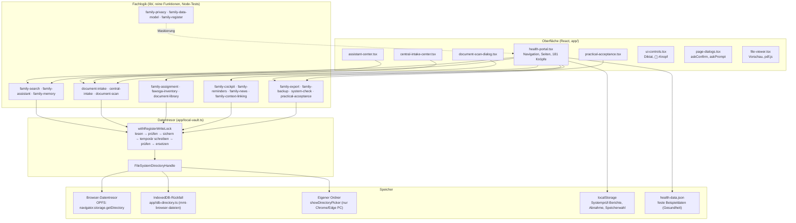
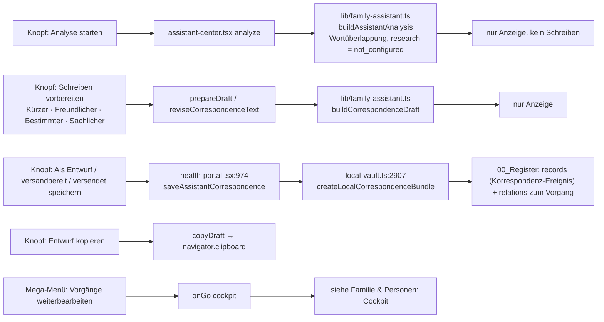
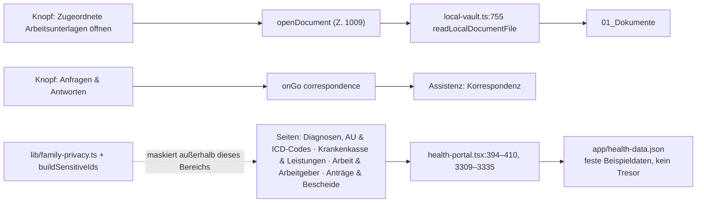
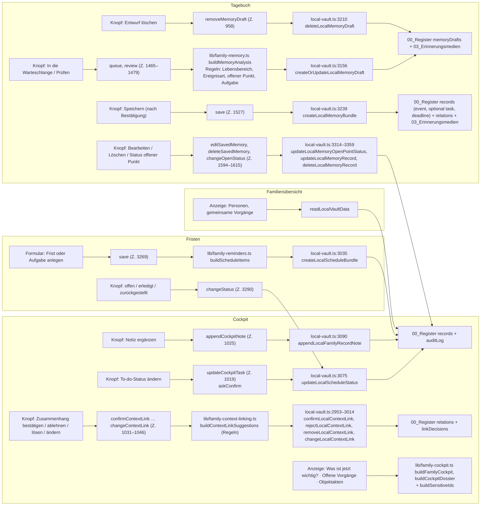
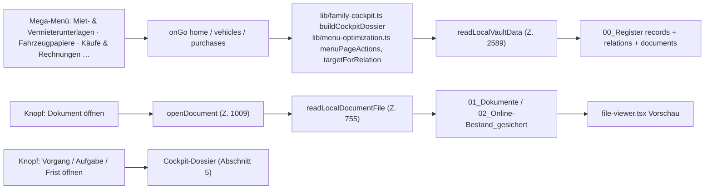
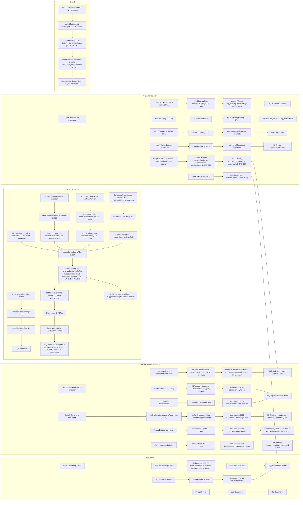
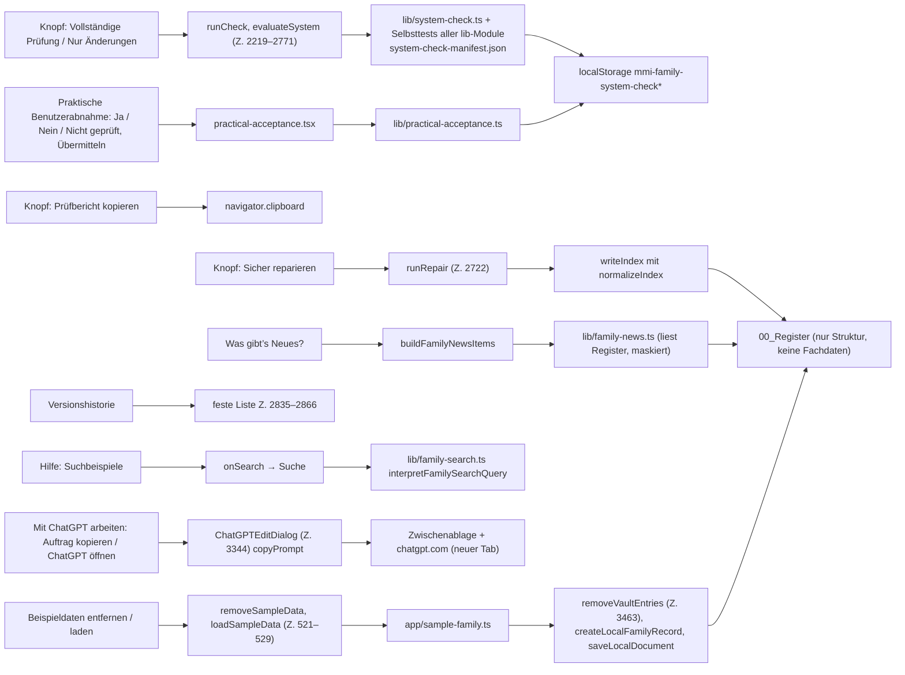
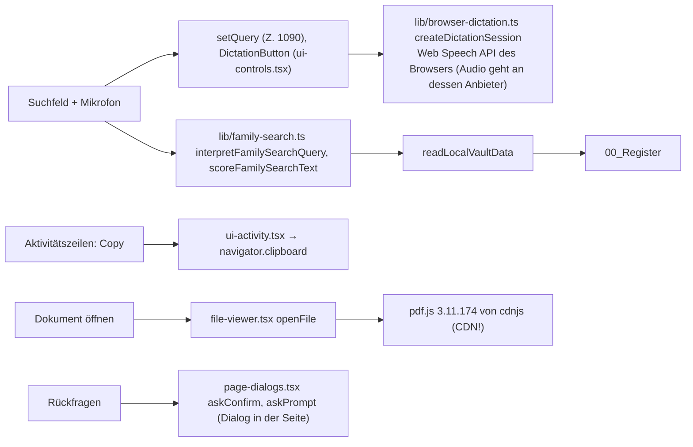

# Paket E: Technischer Baum der Familienakte

Stand 2026-10-28, gelesen im Quelltext von `main`. Jeder Weg geht **Knopf → Handler in `app/*.tsx` →
Fachlogik in `lib/` → Speicherfunktion in `app/local-vault.ts` → Ordner/Datei im Tresor**. Zeilennummern
ohne Dateiangabe beziehen sich auf `app/health-portal.tsx` (Handler) bzw. `app/local-vault.ts` (Tresor).

## 1. Schichten

**Datenschutz-Schicht:** `lib/family-privacy.ts` (`isSensitiveHealthText`, `protectedFamilyLabel`, Wortmuster
`HEALTH_TERMS`) und `lib/family-cockpit.ts` → `buildSensitiveIds` (Z. 189): markiert Dokumente und
Datensätze als sensibel und **vererbt** die Marke über Relationen auf Vorgänge, Aufgaben, Fristen und
Ereignisse. Wirkt nur auf die Anzeige (Cockpit, Suche, Neuigkeiten, Chronologie), nicht auf die Datei.

**Register-Schreibsperre:** `withRegisterWriteLock` (Z. 681): alle Schreibzugriffe laufen nacheinander.
Jeder Schreibvorgang (`writeIndexToRegisterDirectoryUnlocked`, Z. 703) sichert zuerst die vorhandene
Registerdatei nach `00_Register/Sicherungen/Familienakte_Register_<Zeit>.json` (5 Sicherungen bleiben),
schreibt eine temporäre Datei, prüft sie und ersetzt dann `Familienakte_Register.json`.

## 2. Tresor: Ordner und Dateien

Wurzel: `Me_Myself_and_I_Familienakte/` (`ROOT`, Z. 158) im gewählten Ordner oder im Browser-Datentresor.

| Ordner / Datei | Inhalt | schreibt | liest |
| --- | --- | --- | --- |
| `00_Register/Familienakte_Register.json` | das **eine** Register (`VaultIndex` v5): `documents`, `records` (Personen, Organisationen, Objekte, Vorgänge, Aufgaben, Fristen, Ereignisse, Korrespondenz), `relations`, `memoryDrafts`, `linkDecisions`, `inventoryItems`, `inventoryLearningSignals`, `sequences`, `auditLog` | jede Speicherfunktion über `writeIndex` | `readIndex`, `readLocalVaultData` |
| `00_Register/Sicherungen/Familienakte_Register_<Zeit>.json` | automatische Sicherung vor jedem Schreiben, 5 bleiben | `writeIndexToRegisterDirectoryUnlocked` | Systemprüfung/Reparatur |
| `00_Register/*.tmp` | temporäre Datei beim Schreiben (wird ersetzt) | dito | – |
| `00_Posteingang/` | Eingangsordner (nur OneDrive-Tresor) | – | `scanOneDriveInbox` (Z. 331) |
| `01_Dokumente/<Kategorie>/<Datei>` | Originalkopien abgelegter Dokumente | `saveLocalDocument` (Z. 2494), `archiveInventoryItems` (Z. 2341) | `readLocalDocumentFile` (Z. 755) |
| `01_Dokumente/<Kategorie>/Scan-Originale/<DOC-ID>/` | Einzelfotos eines Scans | `saveLocalDocument` mit `scanOriginals` (Z. 2514) | Vorschau |
| `02_Online-Bestand_gesichert/<Kategorie>/` | übernommene Dateien aus der alten Online-Ablage | `saveLocalDocument` mit `migration` (Z. 2502) | Vorschau |
| `03_Erinnerungsmedien/<EVENT-ID>/` | Fotos/Videos zu Tagebucheinträgen und Entwürfen | `createOrUpdateLocalMemoryDraft` (Z. 3128), `createLocalMemoryBundle` (Z. 3252) | `readLocalMemoryMediaFile`, `readLocalMemoryDraftFiles` |
| Export-Ziel `Familienakte_Export_<Zeit>/` (+ `Originaldokumente/`) | JSON + HTML + Kopien | `writeFamilyArchiveExport` (Z. 2613) | – |
| Sicherungs-Ziel `Familienakte_Vollsicherung_<Zeit>/Dateien/01…03` | Register + alle Dateien | `writeFullFamilyBackup` (Z. 2744) | `restoreFullFamilyBackup` (Z. 2791) |
| Archiv-Ziel `Familienakte_Archiv/<Bereich>/<Jahr>/` | geprüfte Kopien aus „Bestand prüfen“ | `archiveInventoryItems` (Z. 2269) | – |
| Testumgebung `Familienakte_Automatische_Testumgebung_2.28.1/01_Analysequelle … 06_Diagnose` | Entwicklerwerkzeug | `runAutomaticTestEnvironment` | – |
| `localStorage` `mmi-family-system-check*`, Abnahme, `mmi-browser-speicher` | Prüfberichte, Benutzerabnahme, Speicherwahl | Systemprüfung, Abnahme | dito |
| IndexedDB `mmi-local-vault/handles` | gemerkte Ordner-Handles (Tresor, OneDrive, Eingang, Bestand, Archiv, Entwicklung) | `chooseVaultFor` (Z. 212) | `rememberedVaultFor` (Z. 230) |

## 3. Assistenz

## 4. Gesundheit & Arbeit

Befund: Die Gesundheitsseiten lesen **keinen** Tresor-Datensatz; sie zeigen `app/health-data.json`. Das
Register kennt zwar Datensätze mit Gesundheitsbezug (Maskierung greift), aber keine Seite zeigt sie als
„Gesundheitsakte“ an.

## 5. Familie & Personen (Cockpit, Familienübersicht, Fristen, Tagebuch)

## 6. Wohnen · Fahrzeuge · Käufe & Garantien (Objektakten)

Diese drei Hauptmenüs haben keine eigene Schreiblogik; sie sind Sichten auf das Register nach Kategorie
(`lib/family-categories.ts`, 18 Kategorien) und auf die Relationen.

## 7. Dokumente (Bibliothek, Bestand prüfen, Eingangszentrale, Sicherheit, Export)

## 8. Hilfe (Hilfe, Systemprüfung, Was gibt’s Neues, Versionshistorie, Datentresor-Hilfe)

## 9. Querschnitt: Kopfleiste, Suche, Diktat, Vorschau

## 10. Befunde aus dem Baum

1. **Ein Register für alles:** jede Speicherfunktion liest und schreibt die ganze
   `Familienakte_Register.json` unter der Schreibsperre. Sicher, aber langsam bei vielen Einträgen
   (Beispielfamilie: rund 7–8 s beim ersten Anlegen).
2. **Gesundheit & Arbeit hängt nicht am Tresor** (`app/health-data.json`).
3. **pdf.js kommt vom CDN** (`app/file-viewer.tsx`): offline und mit Internetschalter „aus“ gibt es keine
   PDF-Vorschau, bis die Bibliothek ins Paket kommt (Teil 2).
4. **Sechs Ordner-Handles** (Tresor, OneDrive, Eingang, Bestandsquelle, Archiv, Entwicklung) liegen in
   IndexedDB `mmi-local-vault`; alle brauchen `showDirectoryPicker` (nur Chrome/Edge am PC). Im
   Browser-Datentresor (OPFS/IndexedDB) gibt es nur den einen Tresor; Eingangsordner, Bestand prüfen,
   Abgleich, Vollsicherung, Wiederherstellung und Export sind dort nicht erreichbar.
5. **Die Datenschutz-Maskierung sitzt in der Anzeige** (`buildSensitiveIds`), nicht in der Datei. Für
   eine KI-Übergabe (Paket C) ist das keine Anonymisierung.
6. **Kein Weg verlässt das Gerät**, außer: Web-Speech-Diktat (Audio an den Browser-Anbieter), pdf.js vom
   CDN und der von Hand geöffnete ChatGPT-Tab.
